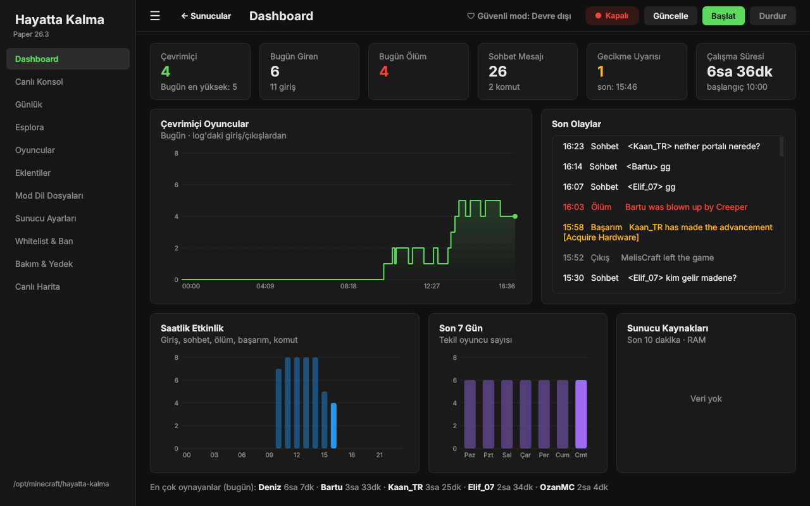
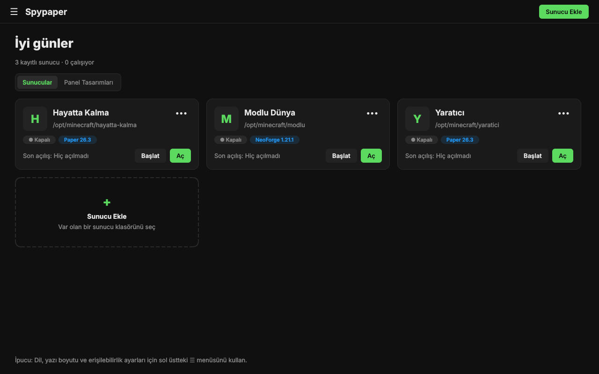
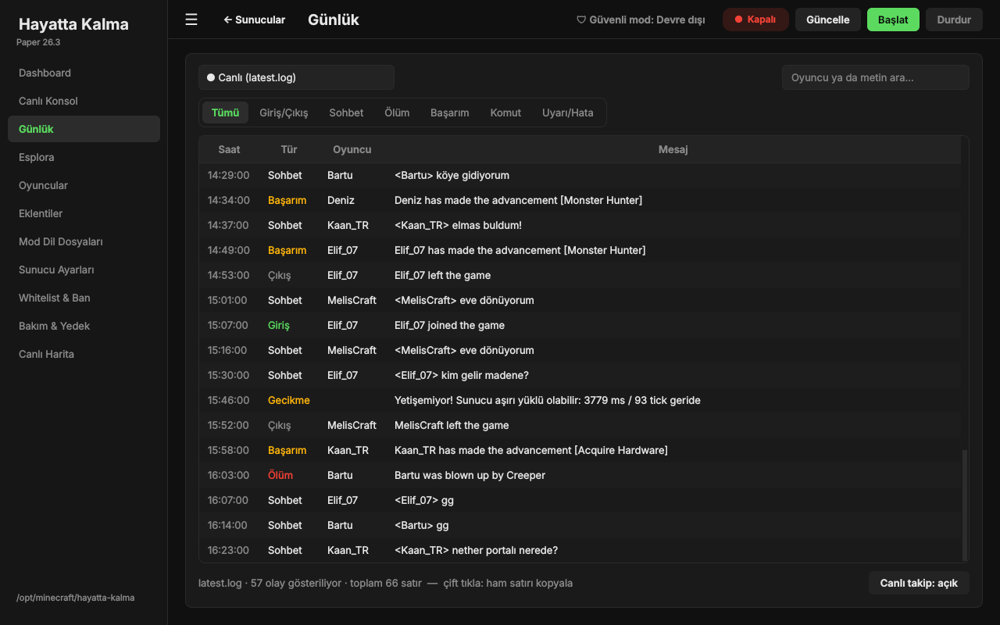
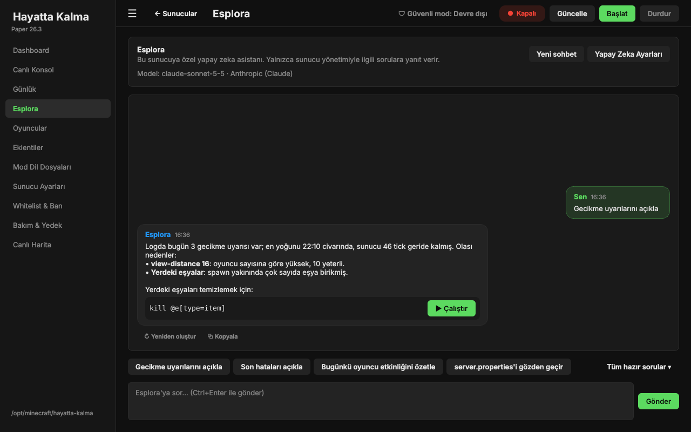
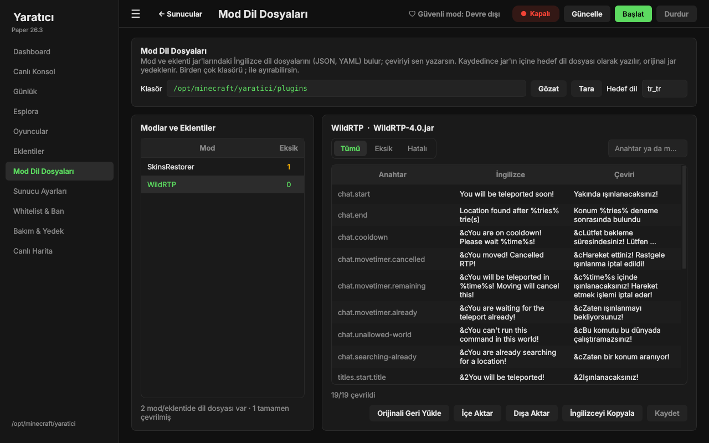
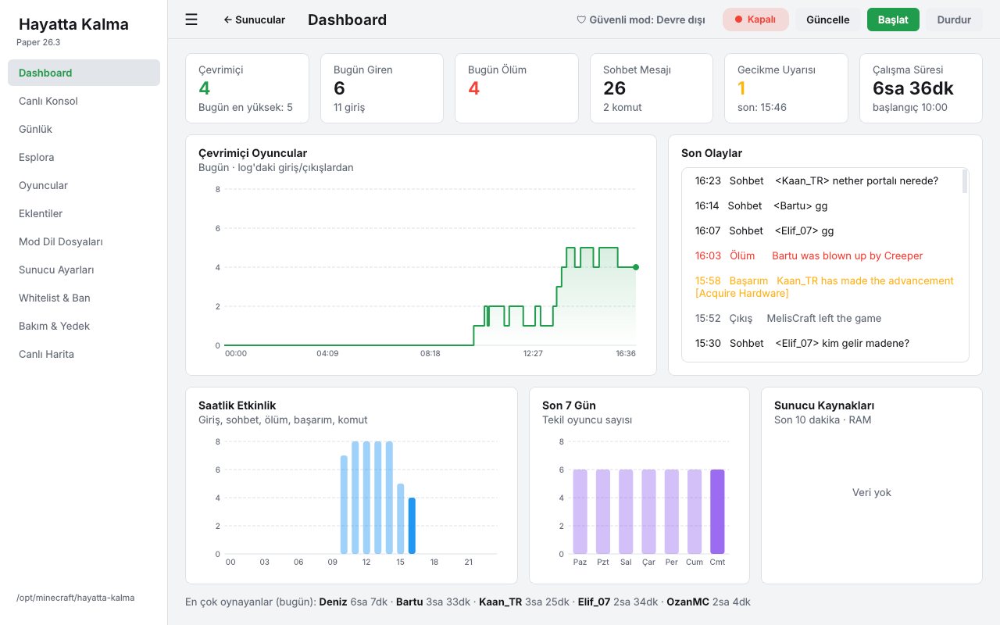
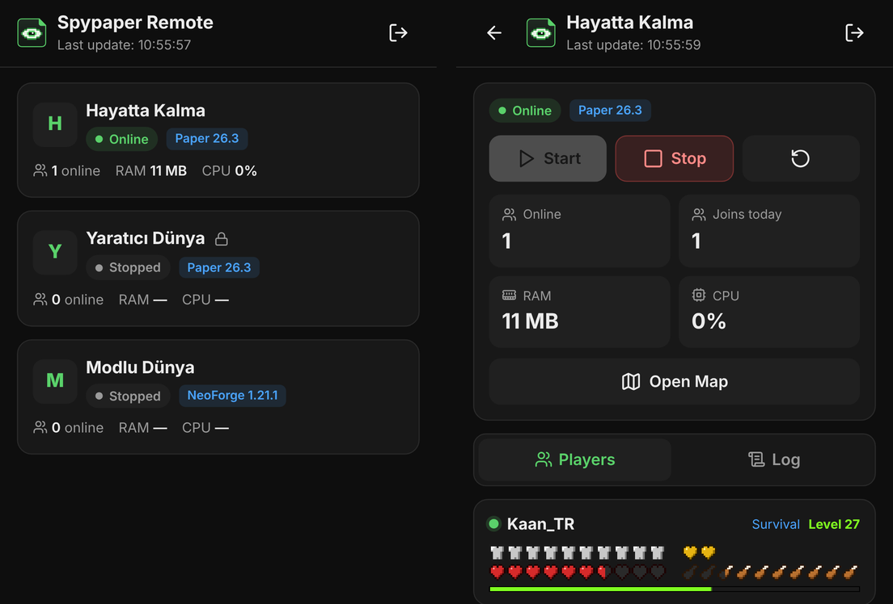
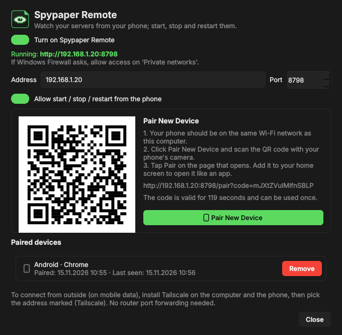

<p align="center"></p>

# Spypaper

**English** · [Türkçe](README.tr.md)

**A desktop management panel for Minecraft servers.** Start and stop your server, watch the console live, look into player inventories, manage plugins and mods, take backups, install or update the server software in one click, view a live BlueMap, and ask **Esplora**, an AI assistant that knows your server.

Written in Python + PySide6 and built as a single `.exe` for Windows. The interface is available in 16 languages. Free and open source (GPL-3.0).

**[⬇ Download the latest release](https://github.com/TyraelDiablo/Spypaper-Releases/releases/latest)** · **[Report a bug / suggest a feature](https://github.com/TyraelDiablo/Spypaper-Releases/issues)**

> Spypaper is not an official Minecraft product. It is not approved by or associated with Mojang Studios or Microsoft.



---

## Features

| Section | What it does |
|---|---|
| **Home screen** | Lists all your servers as cards; quick start/stop, edit and open folder without entering the panel. |
| **New server** | Create a server from scratch: pick the software and Minecraft version, set RAM, port, MOTD, game mode and difficulty; Spypaper downloads the server and prepares the folder. |
| **Dashboard** | Live RAM/CPU, online players, today's joins, deaths, lag warnings and errors, hourly activity chart. |
| **Live Console** | Colored console, command history, optional translation of server messages into the panel language. **Command suggestions as you type:** command names with descriptions, the syntax of the current argument (e.g. `give <player> <item> [count]`) and values to pick from (player names, items, effects, enchantments, game rules, game modes…). Tab or ↑↓ + Enter to accept. |
| **Log** | Events, sessions and charts from `logs/latest.log` and archived `.log.gz` files. Works even if the server was started outside the panel. |
| **Esplora** | An AI assistant (bring your own API key: Anthropic Claude, Google Gemini, OpenAI and compatible services) scoped strictly to managing this server. It gets a built-in expert knowledge base (Java versions, performance tuning, common errors, command syntax by version, networking, permissions…), the **Server Info** you write about your server, and the relevant configuration files (secrets masked). Preset questions by category, chat bubbles, stop and regenerate. It never runs commands itself; you send the commands it suggests with **▶ Run**. |
| **Players** | Health, hunger, armor and XP shown with Minecraft's own HUD bars, and the player's game mode. Inventory, armor and Ender chest with item icons (block items such as fences and stairs are rendered from the game's 3D models), enchantments, armor trims and durability. Item names in your language (from Minecraft's own language files). Common player commands. Supports Minecraft 26.x's new `world/players/` layout. Player heads next to names, account type (premium Mojang/Microsoft account or offline/cracked launcher, from the UUID). **Homes:** up to 10 saved positions per player (XYZ + dimension, or the player's current position) with a Teleport button. |
| **Teams** | Create and delete teams (`/team`), add and remove members, and set color, display name, prefix/suffix, friendly fire, name tag and death message visibility and collision. Teams are read from `scoreboard.dat`, so you can see them even while the server is stopped. |
| **Plugins / Mods** | Manages `plugins/` on Paper, Purpur and Spigot, and `mods/` on Fabric, Quilt, Forge and NeoForge: add, remove, disable. **Modrinth:** search plugins/mods filtered by your server's Minecraft version and loader, install with required dependencies (files verified with SHA-512). **Resource Pack:** pick a resource pack from Modrinth or enter a URL to set as the server resource pack (SHA-1, required/optional). |
| **Mod Language Files** | Finds the English language files inside mod and plugin jars wherever they are (`assets/*/lang/en_us.json`, `lang/en.yml`, `locales/locale.json`…), JSON or YAML, flat or nested. You write the translation; the panel saves it into the jar and into the plugin's own data folder copy. Format code checks (`%s`, `%player%`, `§a`, `&c`, `<red>`), import/export, restore original. |
| **Server Settings** | `server.properties` editor, Java path, RAM, jar, server icon. |
| **Whitelist & Bans** | Whitelist, ban and op lists. |
| **Maintenance & Backups** | World backups (Overworld, Nether, End) and maintenance mode. Maintenance saves and empties the whitelist so nobody gets in even on whitelisted servers, kicks non-OP players and restores everything when it ends. Weekly schedule (days, time, duration) with in-game warnings. See [Maintenance](#maintenance). |
| **Notes** | Your own notes for each server, saved automatically. |
| **Content Editor** | Add content without mods (data pack + resource pack, Minecraft 1.21+): paintings from your images, music discs from a **Newgrounds ID**, a **SoundCloud** link or your own audio file, tools/weapons and food based on existing items with your own damage, speed, durability, enchantments, effects and optional texture, plus a 3×3 crafting recipe. Spypaper can share the resource pack itself. New blocks are not possible without mods. See [Content Editor](#content-editor). |
| **Danger Zone** | PIN-protected page for irreversible actions: reset the world (choose Overworld/Nether/End and the seed), restore a world backup, reset player data, delete the server. See [Danger Zone](#danger-zone). |
| **Crash watchdog** | Optional: restarts a server that shuts down without being stopped; gives up after 3 crashes in 10 minutes. Optional backup limit deletes the oldest backups automatically. |
| **Live Map** | Shows the BlueMap 3D map inside the panel. If BlueMap isn't installed, it downloads the right version for your server software and Minecraft version from Modrinth and (with your consent) enables its texture download. |
| **Server Software** | Pick a version and download/install **Paper, Purpur, Vanilla, Fabric, Forge or NeoForge**. Files are verified with SHA-256 / SHA-1 where available; the old jar is moved to `backups/jars/`. |
| **Spypaper Remote** | Watch your servers from your phone; with the permissions you grant on the computer, start/stop them, run maintenance and change settings. Pair with a QR code; no app store, no account, no database. See [Spypaper Remote](#spypaper-remote-phone). |
| **Updates** | Checks GitHub Releases for a new Spypaper version at startup (can be turned off) and updates the exe in one click. |
| **Security** | 4-level safe mode (confirm, block or read-only for dangerous commands) and an optional per-server PIN. |
| **Appearance** | 7 themes, font size, high contrast, reduced motion, right-to-left languages, [Lucide](https://lucide.dev) icons, themed in-app dialogs instead of Windows message boxes. **Panel Layout:** reorder or hide the panel's tabs and the Dashboard cards. Animated page transitions and a sliding indicator for the selected tab (off with *Reduce motion*). Scrolling over settings no longer changes dropdowns or number fields by accident. Optional start with Windows. |

---

## Screenshots

| | |
|---|---|
|  |  |
| **Home screen:** multiple servers with status and software badges | **Log:** events and sessions from latest.log and archives |
|  |  |
| **Esplora:** server-aware AI, send a suggested command in one click | **Mod Language Files:** translate plugin/mod language files side by side |
|  | |
| **Light theme:** one of 7 themes | |

*Screenshots show the Turkish interface; the app follows the language you choose.*

---

## Requirements

- **Windows 10/11** (also runs on Linux and macOS from source; API key encryption uses Windows DPAPI and is Windows-only).
- **Java** matching your Minecraft version (Java 21 for 1.20.5+, Java 25 for 26.x). The panel does not install Java.
- To run from source or build the exe: [uv](https://docs.astral.sh/uv/) (`winget install astral-sh.uv`). uv downloads a suitable Python by itself; `build.bat` builds with Python 3.12, because brand-new Python versions often lack ready-made packages for PySide6 and others.

---

## Getting started

### With the exe

1. Download `Spypaper.exe` from [Releases](https://github.com/TyraelDiablo/Spypaper-Releases/releases/latest) and put it in a folder (e.g. `D:\Spypaper\`).
2. Open it → **Create New Server** to set up a fresh server, or **Add Existing** to choose a server folder you already have (the jar, version and software are detected automatically).
3. For item names and icons, use **Players → Get Game Files** (see below).

`config.json` is created next to the exe on first start. It holds your server profiles, settings and the encrypted API key, so **don't share it**.

On startup Spypaper briefly shows *Checking for updates…*. If a new version is on GitHub Releases you can update right away (the exe is replaced and Spypaper restarts), later, or skip that version. Turn it off with **☰ → Check for updates on startup**; **☰ → Check for updates now** checks by hand.

### From source

The source code lives in the `src` folder.

```bat
src\calistir.bat
```

or

```bat
cd src
uv run --python 3.12 --with nbtlib --with pyside6 --with psutil --with pyyaml --with segno --with soundfile python main.py
```

### Building the exe

```bat
src\build.bat
```

The result is `src\dist\Spypaper.exe`. Attach only this exe to a release; never `config.json` or the Minecraft folders (`Icons`, `Translation`, `Languages`). The interface translations (`locales/`) and legal texts (`legal/`) are embedded in the exe. Qt WebEngine is included for the built-in map, so the exe is about 150 MB.

---

## Minecraft language files and icons

In-game texts such as item, enchantment and death message names, and the item icons, are read from Minecraft's own files. These files belong to Mojang, so they are **not distributed** with Spypaper; each user prepares them on their own computer.

Use the **Get Game Files** button on the **Players** page or **☰ → Game Files**:

1. **Extract from the Minecraft installation on this computer:** `.minecraft` is found automatically, no internet needed. You must have launched that game version from the launcher at least once.
2. **Download from Mojang's official servers:** for machines without Minecraft (e.g. a dedicated server box). The client jar is downloaded temporarily; only the language files, icons and HUD images are kept and the jar is deleted.

Block items that have no flat picture (fences, stairs, walls, slabs…) are drawn from the game's own 3D models at this step. If you prepared the game files with an older Spypaper version, run **Game Files** again to get these icons and the HUD bars.

Files are written to the `Translation` and `Icons` folders next to the exe. If you prefer the command line, `mc_dilleri_cikar.bat` does the same:

```bat
src\mc_dilleri_cikar.bat                  :: the panel's 16 languages, newest version
src\mc_dilleri_cikar.bat --surum 26.3     :: a specific version
src\mc_dilleri_cikar.bat --hepsi          :: every language in Minecraft
```

---

## Server software

The **Update** button detects your current software and offers newer builds of it; you can also switch to different software.

| Software | Source | Verification | Notes |
|---|---|---|---|
| Paper | PaperMC Fill API v3 | SHA-256 | STABLE channel only |
| Purpur | api.purpurmc.org | — | |
| Vanilla | Mojang version manifest | SHA-1 | Releases only |
| Fabric | meta.fabricmc.net | — | Server launcher jar |
| Forge | files.minecraftforge.net | SHA-1 | Runs the official installer |
| NeoForge | maven.neoforged.net | SHA-1 | Runs the official installer; beta builds are flagged |

Forge (1.17+) and NeoForge servers start from an argument file instead of a jar (`java @user_jvm_args.txt @libraries/.../win_args.txt nogui`). The panel handles this automatically.

> PaperMC asks for a User-Agent with contact information. You can enter an e-mail address or website under ☰ → General.

**Minecraft EULA:** if `eula.txt` hasn't been accepted when the server starts for the first time, the panel asks you. It never accepts the EULA on your behalf.

---

## Maintenance

**Maintenance & Backups → Start Maintenance** (or the schedule) does the following:

1. Saves `whitelist.json` and the whitelist on/off state, empties the whitelist and turns it on, so nobody can join, even on servers that already use a whitelist. OPs can still join.
2. Kicks players who are not OP, changes the MOTD, saves the world and makes a backup.
3. When maintenance ends, restores the whitelist (plus anyone you added during maintenance), its previous on/off state and the old MOTD.

The state is stored in `config.json` and in `backups/whitelist_maintenance.json`, so nothing is lost if Spypaper closes or crashes during maintenance.

**Scheduled maintenance:** choose the days, start time and duration (e.g. every Monday at 04:00 for 30 minutes). Players get warnings 10 min, 5 min, 1 min and 10 s before; maintenance ends by itself when the time is up. The schedule runs only while Spypaper is open (see *Start Spypaper with Windows* in ☰).

---

## Danger Zone

The last tab of each server panel. Entering it requires the server's PIN; if the server has no PIN, you set a separate PIN that is only asked here. It locks again when you leave the page or after 5 minutes.

| Action | What happens |
|---|---|
| Reset World | Deletes the selected dimensions (Overworld, Nether, End). The server creates new ones on next start. Choose a random seed, the same seed or a specific seed; a backup is made first unless you untick it. |
| Restore from Backup | Replaces the current world with a backup from `backups/`. The current world is backed up first unless you untick it. |
| Reset Player Data | Deletes inventories, positions, statistics and advancements; the world stays. |
| Delete Server | Moves the server folder to the Windows Recycle Bin and removes the server from the list. |

Every action requires the server to be stopped and asks you to type the server's name. The Danger Zone is not available from Spypaper Remote. Spypaper refuses to delete a folder that doesn't look like a server, a drive root, your user folder or Spypaper's own folder.

---

## Content Editor

Tab **Content Editor** in each server panel (Minecraft 1.21 or newer). Everything is a vanilla data pack plus a resource pack, so it works on Paper, Purpur, Vanilla, Fabric and the rest, and players don't need mods.

| Type | What you set | Needs the resource pack |
|---|---|---|
| Painting | Image (scaled to 16 px per block), size 1–16 × 1–16 blocks, artist | yes |
| Music Disc | **Newgrounds ID** (downloaded and converted to mono OGG), a **SoundCloud** link (title and artist are filled in and the page opens in your browser; download the file there if the artist allows it) or your own MP3/OGG/WAV/FLAC/AIFF, artist, disc look, comparator signal | yes |
| Tool / Weapon | Base item, attack damage and speed, durability or unbreakable, mining speed bonus, enchantments, glint, optional 16×16 texture (1.21.4+) | only for a texture |
| Food | Base item, nutrition, saturation, eating time, can always eat, effects, optional texture (1.21.2+) | only for a texture |

Every item can have a 3×3 crafting recipe. **Give to Player** runs `loot give <player> loot spypaper:<id>`.

**Build Packs** writes `<world>/datapacks/spypaper_content/` and `spypaper_resourcepack.zip` in the server folder. Paintings and music discs appear after a server restart; tools and food after `/reload`. Players download the resource pack from an address: either let Spypaper share it (*Let Spypaper share the resource pack*, default port 8766; works on your home network and Tailscale, forward the port for players on the internet) or upload the zip somewhere and enter its URL in **Plugins → Resource Pack**. A server has only one resource pack, so this replaces any pack set there.

Plugins/mods: **Check for updates** compares your installed `.jar` files with Modrinth by SHA-1 hash and offers to install newer compatible versions (only when you click it). Every music disc needs the **"I have the right to use and distribute this audio file"** checkbox before it is packed or shared. Spypaper cannot verify copyright; the server owner is responsible for the files used.

If Newgrounds is blocked in your country, use a SoundCloud link or your own file. Newgrounds and SoundCloud tracks belong to their artists; only use tracks you have permission to use. The artist name is shown in the disc description.

---

## Spypaper Remote (phone)

Watch your servers from your phone and, if you allow it, control them. There is no app store app: Spypaper on your computer serves a small mobile web app, and your phone opens it in the browser. Add it to the home screen and it opens like an app (Android and iPhone).



**Setting it up**

1. In Spypaper open **☰ → Spypaper Remote** and turn it on. If Windows Firewall asks, allow access on *Private networks*.
2. Click **Pair New Device** and scan the QR code with your phone's camera. Tap **Pair** on the page that opens.
3. Done. The phone stays paired; you can remove it at any time from the same window.

**What every paired phone can see:** server status, RAM/CPU, players online and today's joins, each player's health, hunger, armor, level and game mode (with Minecraft-style bars), the latest log lines, maintenance status and a link to the BlueMap live map.

**What a phone can do, only with your permission:** permissions are granted per device on the computer (**☰ → Spypaper Remote → Paired devices**):

| Permission | Default for a new device | Allows |
|---|---|---|
| Start / stop | on | Start, Stop, Restart |
| Maintenance | off | Start and end maintenance mode |
| Server settings | off | RAM, maintenance schedule and `server.properties` |

The Java path and jar name can only be changed on the computer, and RCON/query/management settings and passwords are never sent to the phone. There is no free command input.

**Language:** the phone uses its own language if Spypaper has it, otherwise English. You can pick another language under the gear icon on the phone.

**Security**

- Remote is off by default and only works while Spypaper is open on your computer.
- Pairing uses a one-time code that expires after 2 minutes. The phone keeps its key in an HttpOnly cookie; `config.json` only stores a SHA-256 hash of it. No database is involved.
- If a server has a PIN, the phone asks for it for every change (5 wrong tries lock it for 5 minutes). Safe mode *High* (read-only) blocks changes from the phone, and *Allow changes from phones* turns all of them off at once (watch-only).
- IP addresses in log lines are hidden before they reach the phone.
- The connection is plain HTTP inside your own network. **Do not open a port on your router for it.** To reach it from outside (mobile data), install [Tailscale](https://tailscale.com) on the computer and the phone and pick the address marked *(Tailscale)* in the Remote window; the traffic is then encrypted by Tailscale.



---

## Esplora (AI assistant)

1. ☰ → **AI** → choose a provider, enter your API key → **Test Connection**.
2. Use **Fetch Models** to list the models your key can access.

| Provider | Default model | Notes |
|---|---|---|
| Anthropic (Claude) | `claude-sonnet-5-5` | |
| Google Gemini | `gemini-3.8-flash` | If a model is retired and the service suggests a new one, the panel switches automatically |
| OpenAI / compatible | `gpt-4o-mini` | Use the *Server URL* field for OpenRouter, LM Studio, Ollama, etc. |

**Server Info:** Esplora → **Server Info** lets you tell Esplora about your server (rules, staff, economy, how plugins are used, known issues). Esplora also gets the relevant parts of a built-in knowledge base and, when the question is about them, the server's configuration files (`spigot.yml`, `config/paper-world-defaults.yml`, the config of a plugin you name…) with passwords, tokens and webhook URLs replaced by `***`.

**Privacy:** when you ask Esplora something, your question plus the server name, version, settings, plugin/mod list, player names, recent log lines, the latest crash report (if any), your Server Info and the relevant configuration files (secrets masked) are sent to the AI provider you chose. See the [Privacy Notice](src/legal/PRIVACY_EN.md).

The API key is stored in `config.json`; on Windows it is encrypted with DPAPI, bound to your user account.

---

## Interface translations

UI strings are written in Turkish in the code and translated through the tables in `src/tools/translations/*.tsv`. If a translation is missing, the English text is shown.

```bat
cd src
uv run python tools\extract_strings.py      :: lists translatable strings and anything missing
uv run python tools\build_locales.py        :: TSV -> locales\<lang>.json
```

`build_locales.py` reports an error if a translation's placeholders (`{n}`, `{name}`…) don't match the original.

Supported languages: Türkçe, English, Deutsch, Français, Español, Português (Brasil), Italiano, Nederlands, Polski, Русский, Українська, Azərbaycanca, 日本語, 한국어, 简体中文, العربية.

---

## Project layout

```
Spypaper-Releases/
├─ README.md, README.tr.md
├─ LICENSE                 GNU GPL v3
├─ docs/                  logo and README screenshots
└─ src/                    source code
   ├─ main.py              entry point
   ├─ calistir.bat         run from source
   ├─ build.bat            build the exe
   ├─ mc_dilleri_cikar.bat extract Minecraft language files from the command line
   ├─ core/                UI-independent logic
   │  ├─ config.py         settings, server profiles, jar/software detection
   │  ├─ server.py         server process (start, stop, commands)
   │  ├─ software.py       Paper/Purpur/Vanilla/Fabric/Forge/NeoForge providers
   │  ├─ updater.py        downloads and verification
   │  ├─ players.py        player data (NBT), inventory, Minecraft translations
   │  ├─ logwatch.py       latest.log tracking, events, metrics
   │  ├─ logtrans.py       translating server messages into the panel language
   │  ├─ files.py          plugins/mods folder, server.properties, backups
   │  ├─ maintenance.py    maintenance mode, whitelist backup/restore, weekly schedule
   │  ├─ appupdate.py      Spypaper self-update (GitHub Releases)
   │  ├─ danger.py         Danger Zone actions (world reset, restore, delete)
   │  ├─ teams.py          teams (scoreboard.dat, /team commands)
   │  ├─ commands.py       console command syntax and suggestions
   │  ├─ modrinth.py       Modrinth search/download, server resource pack
   │  ├─ content.py        Content Editor (data pack + resource pack builder)
   │  ├─ newgrounds.py     Newgrounds track download
   │  ├─ soundcloud.py     SoundCloud track info (oEmbed)
   │  ├─ packhost.py       resource pack sharing (small HTTP server)
   │  ├─ skins.py, homes.py player heads (Mojang), player homes
   │  ├─ esplora_kb.py     Esplora's built-in knowledge base
   │  ├─ autostart.py      start with Windows
   │  ├─ gamefiles.py      Minecraft language files and icons (local install or Mojang)
   │  ├─ iconrender.py     renders block item icons from the game's 3D models
   │  ├─ modtrans.py       mod/plugin language file editor (JSON, YAML)
   │  ├─ creator.py        creating new servers
   │  ├─ bluemap.py        BlueMap detection, Modrinth install, configuration
   │  ├─ remote.py         Spypaper Remote web server (pairing, phone API)
   │  ├─ ai.py, esplora.py AI providers, Esplora rules and preset questions
   │  ├─ safemode.py       safe mode and PIN
   │  └─ secrets.py        API key encryption
   ├─ ui/                  PySide6 interface (window, pages, themes, i18n, HUD, dialogs)
   │  └─ assets/           Spypaper logo (SVG, PNG, ICO)
   ├─ remote_web/          Spypaper Remote phone app (HTML, CSS, JS)
   ├─ locales/             compiled interface translations
   ├─ tools/               translation and Minecraft language file tools
   └─ legal/               privacy notice, third-party notices, license copy
```

---

## Roadmap

Planned next (order may change; share your ideas on [Issues](https://github.com/TyraelDiablo/Spypaper-Releases/issues)):

- [ ] **Scheduled tasks:** restart at a set time, countdown announcements, commands and backups
- [x] **Crash watchdog:** automatic restart after an unexpected shutdown, stop after repeated crashes
- [x] **Restore from backup** and a backup limit (delete old backups automatically)
- [x] **Teams** and the **Danger Zone**
- [x] **Plugin and mod store:** search and install from Modrinth (with dependencies) and server resource packs
- [ ] Plugin/mod update notices, Hangar
- [x] **Content Editor:** paintings, music discs, tools/weapons, food and recipes without mods
- [x] Console command suggestions, player heads and homes
- [ ] **Discord notifications:** server started, stopped, crashed, player joined (webhook)
- [ ] **Java manager:** detect and download the right Java for your Minecraft version
- [ ] **TPS / MSPT chart** on the Dashboard
- [ ] **Config file editor** (`paper-global.yml`, `config/*.toml`…) with syntax checks
- [x] **Self-update** via GitHub Releases
- [x] **Scheduled maintenance** with whitelist protection
- [x] **Spypaper Remote:** watch and control servers from your phone
- [x] Spypaper Remote: per-device permissions, maintenance, server settings and language
- [ ] Spypaper Remote: chat, player actions and notifications

---

## Troubleshooting

- **Item names are in English or icons are missing:** click **Get Game Files** on the Players page. The bottom of the page shows which language file is in use.
- **The phone can't reach Spypaper Remote:** the phone and computer must be on the same Wi-Fi (guest networks often block this), Windows Firewall must allow Spypaper on private networks, and the address in the Remote window must be your computer's local address (usually `192.168…`). If the port is busy, change it in the Remote window.
- **`'uv' is not recognized` when building:** install uv (`winget install astral-sh.uv`) and open a new terminal.
- **"Failed to build pyyaml" or similar when building:** your Python is too new for some packages. `build.bat` uses Python 3.12 through uv; if you run the commands by hand, add `--python 3.12`.
- **"Minecraft 26.1 and newer requires … Java 25":** install Java 25 (`winget install EclipseAdoptium.Temurin.25.JDK`), then restart Spypaper (or sign out of Windows once). If an older Java is still used, put the full path to Java 25's `java.exe` in **Server Settings → Java**, without quotes.
- **"Couldn't check for updates":** the computer is offline or the releases repository is private; Spypaper starts normally anyway.
- **Player heads show letters instead of faces:** the player has no Mojang account with that name (offline/cracked), Mojang can't be reached, or *Show player heads* is off.
- **Players don't get the Content Editor's paintings/music:** build the packs, restart the server, and make sure players can reach the resource pack address (port 8766 by default when Spypaper shares it).
- **The server won't start:** read the error in the Live Console or ask Esplora *"Why won't the server start?"*. Make sure your Java version matches your Minecraft version.
- **Forge/NeoForge installation failed:** check that the Java path is correct and the server folder is writable; the last lines of the installer output are shown in the window.
- **Gemini/OpenAI error 429:** the provider's rate limit was reached; try again later.

---

## License

Spypaper is free and open-source software licensed under the [GNU General Public License v3](LICENSE) (GPL-3.0).
You may use, study, modify and share it free of charge. If you distribute a modified version, you must share its
source code under the same license. The program comes with no warranty.

Copyright © 2026 Serkan Aynacı ([TyraelDiablo](https://github.com/TyraelDiablo))

## Legal

- [Privacy Notice](src/legal/PRIVACY_EN.md) · [Gizlilik Bildirimi](src/legal/GIZLILIK.md)
- [Third-Party Notices](src/legal/UCUNCU_TARAF.md)

Minecraft is a trademark of Mojang Studios. Spypaper does not distribute any Minecraft files. Running a Minecraft server requires accepting the [Minecraft EULA](https://aka.ms/MinecraftEULA).
