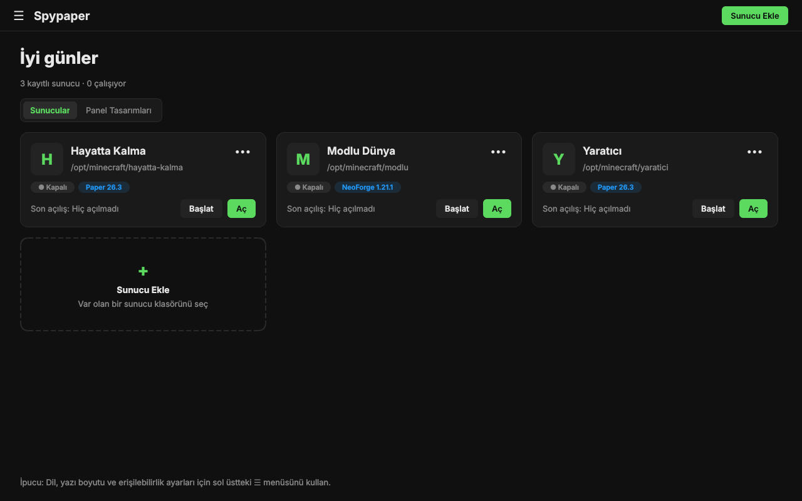
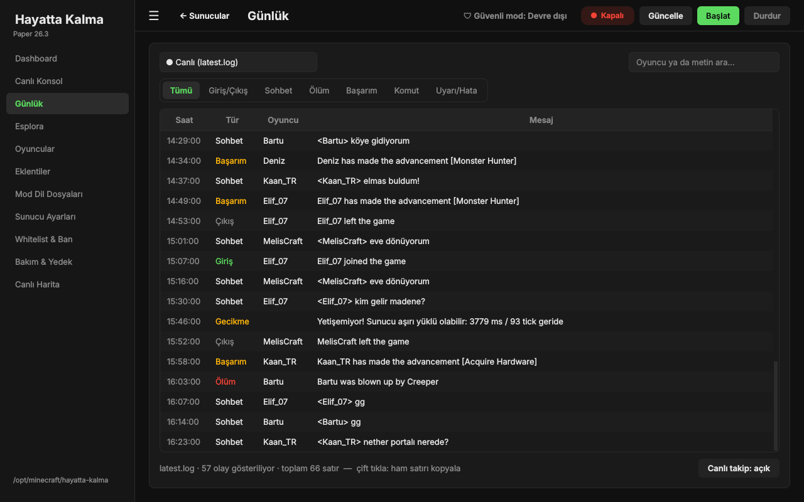
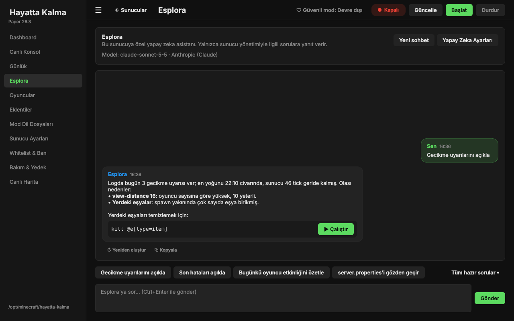
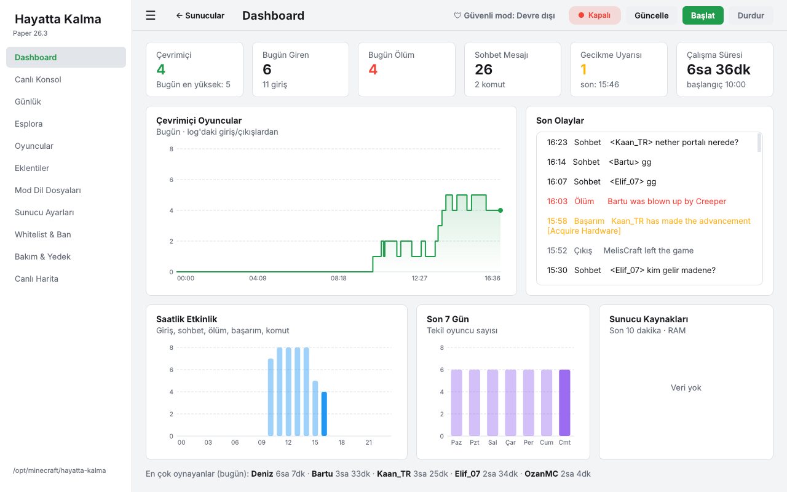

<p align="center"></p>

# Spypaper

[English](README.md) · **Türkçe**

**Minecraft sunucuları için masaüstü yönetim paneli.** Sunucuyu başlat/durdur, konsolu canlı izle, oyuncuların envanterine bak, eklenti ve modları yönet, yedek al, sunucu yazılımını tek tıkla güncelle ve sunucuna özel yapay zeka asistanı **Esplora**'ya danış.

Python + PySide6 ile yazılmıştır, Windows için tek bir `.exe` olarak derlenir. 16 dil desteği vardır. Özgür ve açık kaynaklıdır (GPL-3.0).

**[⬇ Son sürümü indir](https://github.com/TyraelDiablo/Spypaper-Releases/releases/latest)** · **[Hata bildir / öneri yap](https://github.com/TyraelDiablo/Spypaper-Releases/issues)**

> Spypaper resmi bir Minecraft ürünü değildir; Mojang Studios ya da Microsoft ile bağlantısı yoktur.


---

## Özellikler

| Bölüm | Neler yapar |
|---|---|
| **Ana ekran** | Birden çok sunucuyu kartlar halinde listeler; paneli açmadan hızlı başlat/durdur, düzenle, klasörü aç. **Kopyasını Oluştur** (kart menüsü) sunucuyu dünyasıyla ya da dünyasız yeni bir klasöre çoğaltır; loglar ve yedekler kopyalanmaz, kopyaya boş portlar otomatik verilir. **Yazılımı Değiştir / Güncelle…** Sunucu Yazılımı penceresini açar. Güncellemeler ve yazılım değişiklikleri önce **sunucunun bir kopyasında denenebilir** (dünya dahil, yedekler hariç): yalnızca kopya açılırsa asıl sunucu güncellenir; açılmazsa hatalar ve olası suçlu eklenti/mod gösterilir. **Şablon Olarak Dışa Aktar…** sunucu ayarlarını (port, seed ve RCON parolası hariç), eklenti/mod listesini Modrinth sürümleriyle, eklenti/mod metin ayarlarını, zamanlanmış görevleri, bakım planını, hile korumasını ve RAM'i bir `.spytemplate` dosyasına kaydeder; **Şablon Uygula…** onu başka bir (durdurulmuş) sunucuya uygular ve eklentileri Modrinth'ten indirir. Şablona dünya, oyuncu verisi, jar'lar, Discord adresi ve PIN'ler girmez. |
| **Yeni sunucu** | Sıfırdan sunucu oluştur: yazılımı ve Minecraft sürümünü seç; RAM, port, MOTD, oyun modu ve zorluğu ayarla; Spypaper sunucuyu indirip klasörü hazırlar. **Dünya:** normal dünya (seed, dünya tipi, yapılar) ya da hazır **taslak harita**: Skyblock, beş PvP arenası, **OneBlock** (7 aşamada yenilenen tek blok, yalnızca veri paketi), **Parkur** (kontrol noktaları ve bitiş), **Saklambaç** (küçük kasaba) ve **Lobi**. Taslaklar gerektiğinde indirilir, exe'ye gömülmez. **Kendi haritanı içe aktar:** zip/.mcworld ya da dünya klasörü. |
| **Dashboard** | Anlık RAM/CPU, çevrimiçi oyuncular, günlük giriş, ölüm, gecikme ve hata sayıları, saatlik etkinlik grafiği. **Performans:** son 1 saatin TPS ve MSPT (tick süresi) grafiği. Spypaper 15 saniyede bir sunucuya sorar (Paper/Purpur/Spigot: `tps`, `mspt`; Forge/NeoForge: `forge tps`/`neoforge tps`; vanilla ve Fabric 1.20.3+: `tick query`); yanıtlar konsolda gösterilmez, ölçüm kartın üzerinden kapatılabilir. **Performans geçmişi:** TPS, MSPT, RAM, CPU ve oyuncu sayısı son 1 saat, 24 saat ya da 7 gün için; dakikada bir kaydedilir, 8 gün saklanır (`.spypaper/perf`), en düşük/ortalama/en yüksek değerlerle. |
| **Canlı Konsol** | Renkli konsol, komut geçmişi, sunucu mesajlarının panel diline çevrilmesi (isteğe bağlı): Paper, Purpur, Spigot, Vanilla, Fabric, Forge ve NeoForge'un açılış, kapanış, bağlantı, dünya ayarı ve uyarı satırları hazır bir tabloyla 15 dile çevrilir; ölüm, katılma, başarım ve komut yanıtları (ışınlama, eşya verme, OP…) Minecraft'ın dil dosyalarından gelir. Eklenti satırlarına ve sohbete dokunulmaz; panel İngilizceyken satırlar olduğu gibi kalır. **Yazdıkça komut önerisi:** açıklamalı komut adları, o anki argümanın sözdizimi (ör. `give <oyuncu> <eşya> [miktar]`) ve seçilecek değerler (oyuncu adları, eşyalar, efektler, büyüler, oyun kuralları, oyun modları…). Tab ya da ↑↓ + Enter ile seçilir. **Esplora'ya sor:** bir satıra ya da seçime sağ tıkla, Esplora sade bir dille açıklasın (hata satırı yığın izini de götürür). |
| **Günlük** | `logs/latest.log` ve arşivlenmiş `.log.gz` dosyalarından olaylar, oturumlar ve grafikler. Sunucu panel dışında açılmış olsa bile takip eder. |
| **Esplora** | API anahtarıyla çalışan, yalnızca bu sunucunun yönetimine odaklı yapay zeka asistanı (Anthropic Claude, Google Gemini, OpenAI ve uyumlu servisler). Kategorili hazır sorular, mesaj balonları, durdurma ve yeniden oluşturma. Komut çalıştırmaz; önerdiği komutları sen **▶ Çalıştır** ile gönderirsin. Gömülü bir uzman bilgi bankası, yazdığın **Sunucu Bilgileri** ve ilgili yapılandırma dosyalarıyla (gizli değerler maskelenir) cevap verir. Ekran görüntüsü eklenebilir; **Veri İzinleri** Esplora'nın neyi görebileceğini ve neyi sana sorması gerektiğini belirler. **Eğik çizgi komutları (yetenekler):** `/` yazıp seç: `/superobjective` (asıl ne istediğine odaklı derin analiz), `/who` (yalnızca oyuncular ve verileri), `/whappens` (ayarların en kötü senaryo analizi ve endişe seviyesi), `/lag`, `/crash`, `/plugins`, `/secure`, `/explain`, `/short`. Yetenek Esplora'nın göreceği verileri sınırlayabilir. **Kendi yeteneklerini** SKILL.md biçiminde (name, description, scope, effort + talimatlar) **+** düğmesinden oluştur, `.md` olarak içe/dışa aktar. **+** düğmesi metin dosyası da ekler (log, ayar; gizli değerler maskelenir) ve **Samimiyet ayarları**nı açar (resmî/dengeli/samimi/esprili, cevap uzunluğu, emoji, sana nasıl hitap edeceği). **Son Rapor** en yeni zamanlanmış Esplora raporunu gösterir ve Esplora'ya yorumlatır. |
| **Oyuncular** | **Skin Değiştir** (yalnızca bu sunucuda, SkinsRestorer eklentisi/moduyla; Spypaper onu Modrinth'ten kurabilir): başka bir oyuncunun adı ya da PNG skin bağlantısı, klasik ya da ince kol; Spypaper'daki oyuncu kafaları yeni skin'i gösterir. Can, açlık, zırh ve XP Minecraft'ın kendi göstergeleriyle; oyuncunun oyun modu. Envanter, zırh ve Ender sandığı; eşya ikonları (çit, merdiven gibi blok eşyalar oyunun 3D modellerinden çizilir), büyüler, kaplamalar, dayanıklılık. Eşya adları seçili dilde (Minecraft'ın kendi dil dosyalarıyla). Sık kullanılan oyuncu komutları. Minecraft 26.x'in yeni `world/players/` düzenini de okur. İsimlerin yanında oyuncu kafası; hesap türü (UUID'den: lisanslı Mojang/Microsoft hesabı ya da lisanssız başlatıcı). **Evler:** oyuncu başına en fazla 10 kayıtlı konum (XYZ + boyut ya da oyuncunun şu anki konumu) ve Işınla düğmesi. **Oyun geçmişi:** son 7 ve 30 günde oynama süresi, oturum sayısı, en aktif saatler ve son oturumlar. |
| **Takımlar** | Takım oluştur ve sil (`/team`), üye ekle/çıkar; renk, görünen ad, ön ek/son ek, dost ateşi, isim etiketi ve ölüm mesajı görünürlüğü ile çarpışmayı ayarla. Takımlar `scoreboard.dat`'tan okunur, sunucu kapalıyken de görünür. |
| **Eklentiler / Modlar** | Paper, Purpur ve Spigot'ta `plugins/`, Fabric, Quilt, Forge ve NeoForge'da `mods/` klasörünü yönetir: ekle, sil, devre dışı bırak. **Modrinth:** sunucunun Minecraft sürümüne ve yükleyicisine göre süzülmüş eklenti/mod arama, gerekli bağımlılıklarıyla kurma (dosyalar SHA-512 ile doğrulanır). **Kaynak Paketi:** Modrinth'ten bir kaynak paketi seç ya da adres gir, sunucu kaynak paketi olsun (SHA-1, zorunlu/isteğe bağlı). **Spypaper Modları:** tek tıkla kurulan hazır veri ve kaynak paketleri; tüm sunucu türlerinde çalışır, oyuncuların bir şey kurması gerekmez: **Düz can ve açlık barı** (kalp, açlık, zırh ve hava düz dolan barlar olarak görünür; İçerik Editörü'nün kaynak paketi paylaşımıyla gider), **Ölüm koordinatları** (ölen oyuncu nerede öldüğünü yalnızca kendi sohbetinde görür) ve **Eşyalar kaybolmasın** (yere düşen ve ölünce düşen eşyalar 5 dakika sonra kaybolmaz). |
| **Mod Dil Dosyaları** | Mod ve eklenti jar'larının içindeki İngilizce dil dosyalarını, yolu ne olursa olsun bulur (`assets/*/lang/en_us.json`, `lang/en.yml`, `locales/locale.json`…). JSON ve YAML, düz ya da iç içe. Çeviriyi sen yazarsın; panel jar'ın içine ve eklentinin kendi klasöründeki kopyaya kaydeder. Biçim kodu kontrolü (`%s`, `%player%`, `§a`, `&c`, `<red>`), dışa/içe aktarma, orijinali geri yükleme. |
| **Sunucu Ayarları** | `server.properties` düzenleyici, Java yolu, RAM, jar, sunucu ikonu. **Java Yöneticisi:** bilgisayardaki Java'ları (Minecraft Launcher'ınkiler dahil) bulur, sunucunun Minecraft sürümüne uygun olanı önerir ya da Eclipse Temurin'i SHA-256 doğrulamasıyla Spypaper'ın yanındaki `java` klasörüne indirir (sisteme kurmaz). Sunucu başlarken seçili Java çok eskiyse ya da bulunamıyorsa uyarır. **Yaş etiketi:** MOTD'nin başına `[13+]` gibi renkli bir etiket ekler; sunucu listesindeki görünümü canlı önizlenir. **Dünya Sınırı:** iki köşe (X/Z) ya da merkez ve yarıçap gir; Spypaper Overworld, Nether ya da End için `/worldborder` gönderir, istersen geçiş süresiyle. Sınır her zaman karedir; dikdörtgen girersen uzun kenarı kapsar. |
| **Yapılandırma** | Sunucunun ayar dosyalarını (`paper-global.yml`, `spigot.yml`, `world/paper-world.yml`, `config/*.toml`, eklenti `config.yml`'leri…) panelin içinde düzenle: satır numaraları, renklendirme, yazarken YAML/TOML/JSON biçim denetimi. Hata satırı kırmızıyla işaretlenir ve Türkçe açıklanır (Tab, girinti, kapanmamış tırnak/parantez, aynı anahtarın iki kez yazılması…). Yorumlar ve sıra korunur; kaydetmeden önce eski hal `backups/configs`'e kopyalanır, yedeklerden geri yüklenebilir. Dosya dışarıda değiştiyse üzerine yazmadan sorar. |
| **Dosyalar** | Sunucu klasörünün tamamı boyut ve tarihleriyle ağaç halinde, adla arama. Çift tıklayınca dosya VS Code, Notepad++, Not Defteri ya da varsayılan programda açılır (kendiliğinden bulunur, seçilebilir). Metin olmayan dosyalar (jar, dünya, oyuncu verisi) çalıştırılmaz, Gezgin'de gösterilir. Sağ tık: birlikte aç, Spypaper'da düzenle, klasörde göster, yolu kopyala, Geri Dönüşüm Kutusu'na taşı (yalnızca sunucu kapalıyken). |
| **Whitelist & Ban** | Whitelist, ban ve op listeleri. **Uyar, At, Banla** (kalıcı ya da süreli: 1 saatten 30 güne, Spypaper açıkken süresi dolunca kendiliğinden kalkar) ve **Banı Kaldır**, nedeniyle; hepsi oyuncu adına göre süzülebilen **Sicil**'e yazılır. |
| **Bakım & Yedek** | Dünya (Overworld, Nether, End) yedeği ve bakım modu. **Yapı yüksekliği** (Sunucu Ayarları): Overworld'ün en alt/en üst Y'si, oyunun kendi boyut dosyasından üretilen bir veri paketiyle; −2032…2031'e kadar hazır seçenekler, −64'ün altına inince yeni bölgelerde isteğe bağlı derin arazi üretimi (Paper/Purpur/Folia'da Y −55 altındaki mağara lavını havaya çeviren, tabanın 10 blok üstünü bırakan küçük bir eklenti de isteğe bağlı), önerilen RAM (varsayılan 4 GB, Y 640'a kadar 6 GB, 1024'e kadar 8 GB, üstü daha fazla) ve sunucuda daha az varsa uyarı ile **RAM'i Artır** butonu. **Harita Olarak Dışa Aktar** dünyayı oyuncu verisi, istatistik ve ilerlemeler olmadan paylaşılabilir bir zip'e çevirir (Bukkit'in ayrı Nether/End klasörleri birleştirilir). Bakımda whitelist yedeklenip boşaltılır, böylece whitelist kullanan sunuculara da kimse giremez; OP olmayan oyuncular atılır, bakım bitince her şey geri gelir. Gün, saat ve süreli haftalık plan, oyun içi uyarılarla. Bkz. [Bakım](#bakım). **Dünyayı Önceden Oluştur:** Chunky eklentisi/modu ile (Modrinth'ten tek tıkla kurulur) seçilen boyut, merkez ve yarıçapta ya da dünya sınırı kadar chunk'ı önceden üretir; ilerleme, duraklat/devam/iptal ve oyuncu varken kendiliğinden duraklama. |
| **Zamanlanmış Görevler** | Seçili günlerde belirli saatte ya da belli aralıklarla (ör. her 30 dakikada) yeniden başlatma, durdurma, başlatma, dünya yedeği, konsol komutları ve duyurular. Yeniden başlatma ve durdurmada oyunculara isteğe bağlı geri sayım (10 dk, 5 dk, 1 dk, 10 sn). Hazır şablonlar, *Şimdi Çalıştır*, her görevin sonraki çalışma zamanı ve son sonucu. Komutlar güvenli moddan geçer. Görevler yalnızca Spypaper açıkken çalışır. **Esplora raporu:** son çalışmadan bu yana performans, oyuncular, sicil, yedekler ve boş diskin uyarılarla özeti; `.spypaper/reports` içine kaydedilir, Esplora sayfasında görünür ve Discord'a gönderilir. Yapay zeka anahtarı gerekmez. |
| **Discord** | Sunucu olaylarını bir Discord kanalına gönderir: açıldı, kapandı, çöktü, oyuncu girdi/çıktı/öldü, başarımlar, sohbet, bakım ve zamanlanmış görevler (her biri ayrı açılıp kapanır). Bot ya da hesap gerekmez; kanalın webhook adresini yapıştırırsın, adres bu bilgisayarda şifreli saklanır. Test mesajı, Discord'un hız sınırına uyum, mesajlarda @everyone ve etiketler hiçbir zaman çalışmaz. Oyuncu olayları yalnızca Spypaper'ın başlattığı sunucularda çalışır. Esplora raporları da gönderilebilir. |
| **Notlar** | Her sunucu için kendi notların; kendiliğinden kaydedilir. |
| **İçerik Editörü** | Mod olmadan içerik ekle (veri paketi + kaynak paketi, Minecraft 1.21+): kendi resimlerinden tablo, **Newgrounds ID**'si ya da kendi ses dosyandan müzik diski, var olan eşyalardan hasarı, hızı, dayanıklılığı, büyüleri, efektleri ve isteğe bağlı dokusu senin belirlediğin alet/silah ve yiyecek; 3×3 tarif. Kaynak paketini Spypaper kendisi paylaşabilir. **Doku Tasarımı:** Tasarla… ile 16×16 eşya dokusunu, tabloyu ya da HUD parçasını piksel piksel boya (kalem, silgi, kova, damlalık, ayna, geri al); alet, yiyecek ve plak şablonlarından başla; eşyaya istersen 16×16×16 **blok (küp) görünümü** ver ya da katman katman, küçük küplerle gerçek bir **3B model** yap (16×16×16; düz dokudan da oluşturulabilir, model elemanlarına dönüştürülür). Mod olmadan yeni blok eklenemez. Bkz. [İçerik Editörü](#i̇çerik-editörü). |
| **Hile Koruması** | İşlevine göre adlandırılmış modüller: **Cevher Gizleme** (Paper/Purpur'un yerleşik anti-xray'i, X-Ray paketlerini işe yaramaz yapar), **Yetki Koruması** (panelden verilmeyen OP'u geri alır, oyuncuyu atar), **Savaş Hilesi Denetimi** (killaura, uzaktan vurma, uçma ve hız için açık kaynak GrimAC eklentisini Modrinth'ten tek tıkla kurar), **Bot Doğrulaması** (sunucunun kaynak paketini gerçekten indirmeyen oyuncuyu atar). Tek anahtarla hilelere izin verilip hepsi kapatılabilir. Bkz. [Hile Koruması](#hile-koruması). |
| **Tehlikeli Bölge** | Geri alınamayan işlemler için PIN korumalı sayfa: dünyayı sıfırla (Overworld/Nether/End ve seed seçerek), dünya yedeğini geri yükle, oyuncu verilerini sıfırla, sunucuyu sil. Bkz. [Tehlikeli Bölge](#tehlikeli-bölge). Yedekten geri yükleme artık seçmeli: tüm dünya, yalnızca Overworld/Nether/End/oyuncu verisi ya da tek oyuncu, ya da X/Z çevresindeki bir bölge. **Dünya Temizliği:** oyuncuların N dakikadan az kaldığı chunk'ları siler, doğma noktası çevresini korur, önce önizleme gösterir. |
| **Çökme bekçisi** | İsteğe bağlı: durdurulmadan kapanan sunucuyu yeniden başlatır; 10 dakikada 3 kez çökerse vazgeçer. İsteğe bağlı yedek sınırı en eski yedekleri kendiliğinden siler. Her çökmeden sonra yığın izine bakıp **olası suçlu eklentiyi/modu** konsola yazar. Spypaper kapanırken sunucu açık kalmışsa, Spypaper açılınca sunucuya **yeniden bağlanır** (konsol log'dan, komutlar RCON'la). Aynı anda yalnızca bir Spypaper açılabilir. |
| **Canlı Harita** | BlueMap 3D haritası panelin içinde açılır. BlueMap kurulu değilse sunucunun yazılımına ve sürümüne uygun olanı Modrinth'ten indirip kurar, doku indirme iznini (onayınla) ayarlar. |
| **Sunucu Yazılımı** | **Paper, Purpur, Folia, Vanilla, Fabric, Forge, NeoForge, Velocity** için sürüm seçip indirme/kurma. Mümkün olduğunda SHA-256 / SHA-1 doğrulaması yapılır, eski jar `backups/jars/` klasörüne taşınır. **Yazılım değiştirme** (ör. Paper → Fabric) klasörü hazırlar: uyumsuz eklenti/modlar silinmez, `backups/switch-…/` içine taşınır; Vanilla ve mod yükleyicilere geçerken Paper'ın ayrı `world_nether`/`world_the_end` klasörleri dünyaya geri birleştirilir. Dünya, oyuncu verileri, whitelist, banlar ve OP'ler korunur. |
| **Spypaper Remote** | Sunucularını telefondan izle; bilgisayardan verdiğin izinlerle başlat/durdur, bakıma al ve ayarlarını değiştir. QR kodla eşleşir; mağaza, hesap ya da veritabanı gerekmez. Bkz. [Spypaper Remote](#spypaper-remote-telefon). |
| **Güncelleme** | Açılışta GitHub Releases'ta yeni Spypaper sürümü olup olmadığına bakar (kapatılabilir) ve exe'yi tek tıkla günceller. |
| **Güvenlik** | 4 seviyeli güvenli mod (tehlikeli komutlar için onay, engelleme ya da salt okunur) ve sunucu başına isteğe bağlı PIN. |
| **Oyunculara Giden Mesajlar** | Sunucu Ayarları → **Oyunculara Giden Mesajlar**: Spypaper'ın kendi uyarıları, geri sayımları ve atma mesajları (bakım, zamanlanmış yeniden başlatma, hile koruması) her oyuncuya kendi oyun dilinde gider. Paper/Purpur/Folia'da küçük **SpypaperMessages** eklentisi (tek tık) her oyuncunun oyun dilini bilir ve metni panelin 16 dilinden ve Language Wizard'la yaptığın dillerden seçer; diğer diller İngilizce görür. Eklenti yoksa uyarılar paylaşılan Spypaper kaynak paketiyle çevrilir, atma mesajları panel dilinde + İngilizce gider (atılan oyuncunun oyunu, sebebi göstermeden önce sunucu paketini bıraktığı için atma mesajları eklenti ister). Eklentiyle Oyuncular sayfası her oyuncunun oyun dilini de gösterir. |
| **Botlar** | Oyuncular → **Botlar**: AFK farmlarda oyuncunun yerine duran sahte oyuncular; gece nöbetine gerek kalmaz. Paper/Purpur'da Spypaper'ın kendi bot motoru (SpypaperMessages eklentisinin içinde, tek tık), Fabric'te Carpet kullanılır. Ad, dünya, konum ve bakış (ya da bir oyuncunun yerini al) ile iş seçilir: sadece dur (chunk'ları yüklü tutar), vur (mob farmı), sağ tıkla ya da eğil; sürekli veya her N tick'te. Botlar sunucu açılınca otomatik gelebilir; hile koruması ve bakım modu onlara dokunmaz, oyuncu sayılarında ve raporlarda ayrı tutulurlar. Ölen bot bir saniye sonra aynı yerde, aynı işle geri gelir. |
| **Language Wizard** | ☰ → **Language Wizard**: Spypaper'ı istediğin dile çevir. Üstte İngilizce kaynak metin, altta senin çevirin; eksikler/tümü süzgeci, arama, yer tutucu denetimi, Ctrl+Enter ile sonraki metin. Exe'nin yanındaki `Languages/<dil>_<ÜLKE>.json` dosyasına kaydedilir (ör. `de_AT.json`), istersen VS Code'da da düzenlersin (**VS Code'da Aç**); dil sonra dil listesinde görünür. **Yapay zekâyla çevir** (tek metin ya da tüm eksikler) Esplora'nın yapay zekâ ayarlarını ve API anahtarını kullanır. **Minecraft Dil Dosyasını Çıkar** oyunun o dildeki kendi dil dosyasını alır (Oyun Dosyaları → *Yalnızca seçilen dil*). |
| **Görünüm** | Açılışta kısa karşılama ekranı (büyük Spypaper yazısı ve günün saatine göre selamlama; tıklayınca geçilir, menüden kapatılabilir), sayfa ve sekme geçişlerinde hafif solma; 7 tema, yazı boyutu, ölçü birimi (metrik ya da feet/mil; yürünen mesafe ve dünya sınırı boyutu), yüksek kontrast, animasyonları azaltma, sağdan sola diller, [Lucide](https://lucide.dev) ikonları, Windows mesaj kutuları yerine panele özel uyarı/soru pencereleri. Sunucu panelinin kenar çubuğu gruplara ayrılır (Genel, Oyuncular, İçerik, Sunucu, Otomasyon, Güvenlik); grup başlığına tıklayınca açılıp kapanır, durum hatırlanır. **Panel Düzeni:** paneldeki sekmeleri (grup içinde) ve Dashboard kartlarını sırala ya da gizle. Sayfa geçiş animasyonları ve seçili sekmede kayan gösterge (*Animasyonları azalt* ile kapanır). Ayarlarda kaydırırken açılır listeler ve sayı kutuları artık kazara değişmez. Renkli butonlar göz yormayan tonlu bir stilde (yüksek kontrastta dolu). İsteğe bağlı Windows ile başlatma. |

---

## Ekran görüntüleri

| | |
|---|---|
|  |  |
| **Ana ekran:** birden çok sunucu, durum ve yazılım rozetleri | **Günlük:** latest.log ve arşivlerden olaylar, oturumlar |
|  |  |
| **Esplora:** sunucuya özel yapay zeka, önerilen komutu tek tıkla gönder | **Mod Dil Dosyaları:** eklenti/mod dil dosyalarını yan yana çevir |
|  | |
| **Açık tema:** 7 temadan biri | |

---

## Gereksinimler

- **Windows 10/11** (geliştirme sırasında Linux ve macOS'ta da çalışır; API anahtarı şifrelemesi yalnızca Windows'ta DPAPI ile yapılır).
- **Java**: Minecraft sürümüne uygun (1.20.5 ve sonrası için Java 21, 26.x için Java 25). Panel Java'yı kendisi kurmaz.
- Kaynaktan çalıştırmak ya da exe derlemek için: [uv](https://docs.astral.sh/uv/) (`winget install astral-sh.uv`). Uygun Python'u uv kendisi indirir; `build.bat` Python 3.12 ile derler, çünkü çok yeni Python sürümlerinde PySide6 gibi paketlerin hazır derlenmiş hali genelde henüz yoktur.

---

## Hızlı başlangıç

### Hazır exe ile

1. [Releases](https://github.com/TyraelDiablo/Spypaper-Releases/releases/latest) sayfasından `Spypaper.exe` dosyasını indirip bir klasöre koy (ör. `D:\Spypaper\`).
2. Exe'yi aç → sıfırdan kurmak için **Yeni Sunucu Oluştur**, elindeki bir sunucu için **Var Olanı Ekle** (jar, sürüm ve yazılım otomatik algılanır).
3. Eşya adları ve ikonlar için **Oyuncular → Oyun Dosyalarını Al** (aşağıya bak).

`config.json` ilk açılışta exe'nin yanında oluşur. Sunucu profilleri, ayarlar ve şifrelenmiş API anahtarı buradadır, **paylaşma**.

Spypaper açılırken kısa bir süre *Güncellemeler denetleniyor…* yazar. GitHub Releases'ta yeni sürüm varsa hemen güncelleyebilir (exe değiştirilir ve Spypaper yeniden açılır), sonraya bırakabilir ya da o sürümü atlayabilirsin. **☰ → Açılışta güncellemeleri denetle** ile kapatılır; **☰ → Güncellemeleri şimdi denetle** elle denetler.

### Kaynaktan

Kaynak kod `src` klasöründedir.

```bat
src\calistir.bat
```

ya da

```bat
cd src
uv run --python 3.12 --with nbtlib --with pyside6 --with psutil --with pyyaml --with segno --with soundfile python main.py
```

### Exe derleme

```bat
src\build.bat
```

Çıktı `src\dist\Spypaper.exe` olur. Release'e yalnızca bu exe'yi ekle; `config.json`'ı ve Minecraft klasörlerini (`Icons`, `Translation`, `Languages`) asla ekleme. Dil dosyaları (`locales/`) ve yasal metinler (`legal/`) exe'nin içine gömülür. Gömülü harita için Qt WebEngine de pakete girdiğinden exe 150 MB civarındadır.

---

## Minecraft dil dosyaları ve ikonlar

Eşya, büyü ve ölüm mesajı gibi oyun metinleri ve eşya ikonları Minecraft'ın kendi dosyalarından okunur. Bu dosyalar Mojang'a ait olduğu için Spypaper ile **dağıtılmaz**; her kullanıcı kendi bilgisayarında hazırlar:

**Oyuncular** sayfasındaki **Oyun Dosyalarını Al** düğmesi ya da **☰ → Oyun Dosyaları** ile:

1. **Bu bilgisayardaki Minecraft kurulumundan çıkar:** `.minecraft` otomatik bulunur, internet gerekmez. Önce oyunun o sürümünü launcher'dan bir kez açmış olman gerekir.
2. **Mojang'ın resmî sunucularından indir:** Bilgisayarda Minecraft yoksa (ör. yalnızca sunucu makinesi) kullanılır. İstemci jar'ı geçici olarak indirilir, yalnızca dil dosyaları, ikonlar ve HUD görselleri ayrılıp jar silinir.

Düz resmi olmayan blok eşyalar (çit, merdiven, duvar, basamak…) bu adımda oyunun kendi 3D modellerinden çizilir. Oyun dosyalarını eski bir Spypaper sürümüyle hazırladıysan bu ikonlar ve can/açlık çubukları için **Oyun Dosyaları**'nı yeniden çalıştır.

Dosyalar exe'nin yanındaki `Translation` ve `Icons` klasörlerine yazılır. Komut satırını tercih edenler için `mc_dilleri_cikar.bat` da aynı işi yapar:

```bat
src\mc_dilleri_cikar.bat                  :: panelin 16 dili, en yeni sürüm
src\mc_dilleri_cikar.bat --surum 26.3     :: belirli sürüm
src\mc_dilleri_cikar.bat --hepsi          :: Minecraft'taki tüm diller
```

---

## Sunucu yazılımları

**Güncelle** düğmesi mevcut yazılımı algılar ve aynı yazılımın yeni sürümünü önerir; istersen başka bir yazılıma geçebilirsin.

| Yazılım | Kaynak | Doğrulama | Not |
|---|---|---|---|
| Paper | PaperMC Fill API v3 | SHA-256 | Yalnızca STABLE kanal |
| Purpur | api.purpurmc.org | — | |
| Vanilla | Mojang sürüm listesi | SHA-1 | Yalnızca kararlı sürümler |
| Fabric | meta.fabricmc.net | — | Sunucu başlatıcı jar'ı |
| Forge | files.minecraftforge.net | SHA-1 | Kurulum programı çalıştırılır |
| NeoForge | maven.neoforged.net | SHA-1 | Kurulum programı çalıştırılır; beta sürümler işaretlenir |
| Velocity | PaperMC Fill API v3 | SHA-256 | Proxy; aşağıya bak |

**Velocity (proxy):** diğer sunucular gibi oluşturulur (varsayılan port 25577). Proxy'nin dünyası olmadığı için dünya, oyuncu ve `server.properties` sekmeleri gizlenir, **Velocity Ağı** sekmesi çıkar: dinleme adresi, MOTD, online-mode, bilgi aktarım modu ve giriş sırasıyla bağlı sunucular. **Spypaper Sunucusu Ekle** Paper/Purpur/Folia sunucularından birini tek tıkla bağlar: `paper-global.yml`'de ortak `forwarding.secret` ile Velocity modern aktarımı açılır, `online-mode=false` yapılır (hesapları proxy doğrular). İnternete yalnızca proxy'nin portunu aç. Waterfall/BungeeCord desteği sonlandığı için sunulmuyor.

Forge (1.17+) ve NeoForge sunucuları jar ile değil, `libraries/.../win_args.txt` argüman dosyasıyla başlatılır. Panel bunu otomatik yapar (`java @user_jvm_args.txt @libraries/.../win_args.txt nogui`).

> PaperMC, isteklerde iletişim bilgisi içeren bir User-Agent ister. ☰ → Genel bölümünden e-posta ya da site adresini girebilirsin.

**Minecraft EULA:** Sunucu ilk kez başlatılırken `eula.txt` kabul edilmemişse panel sana sorar. Panel EULA'yı senin yerine kabul etmez.

---

## Bakım

**Bakım & Yedek → Bakım Modunu Başlat** (ya da plan) şunları yapar:

1. `whitelist.json`'ı ve whitelist'in açık/kapalı durumunu saklar, whitelist'i boşaltıp açar. Böylece zaten whitelist kullanan sunuculara da kimse giremez. OP'ler yine girebilir.
2. OP olmayan oyuncuları atar, MOTD'yi değiştirir, dünyayı kaydedip yedek alır.
3. Bakım bitince whitelist'i (bakım sırasında eklediklerinle birlikte), önceki açık/kapalı durumunu ve eski MOTD'yi geri getirir.

Durum `config.json`'da ve `backups/whitelist_maintenance.json`'da tutulur; Spypaper bakım sırasında kapansa ya da çökse bile hiçbir şey kaybolmaz.

**Otomatik bakım:** günleri, başlangıç saatini ve süreyi seç (ör. her Pazartesi 04:00'te 30 dakika). Oyunculara 10 dk, 5 dk, 1 dk ve 10 sn önce uyarı gider; süre dolunca bakım kendiliğinden biter. Plan yalnızca Spypaper açıkken çalışır (☰'deki *Windows açılınca Spypaper'ı başlat* seçeneğine bak).

---

## Uyku modu ve kapatma

**☰ → Uyku Modu** Spypaper'ın üstüne saati ve sunucuların durumunu (çalışıyor mu, oyuncu sayısı, TPS) gösteren bir kilit ekranı koyar; sunucular çalışmaya devam eder. Panele dönmek, pencereyi kapatmak ya da klavye kısayolları ilk kullanımda belirlenen PIN'i ister. **☰ → Spypaper'ı Kapat** çalışan sunucuları düzgünce durdurur ve kısa bir "Have fun with your Minecraft server" ekranıyla uygulamayı kapatır. Spypaper açılışta penceresini öne getirir.

## Tehlikeli Bölge

Her sunucu panelinin son sekmesi. Girmek için sunucunun PIN'i gerekir; sunucuda PIN yoksa sunucunun adını yazarak girersin. Sayfadan çıkınca ya da 5 dakika sonra yeniden kilitlenir.

| İşlem | Ne olur |
|---|---|
| Dünyayı Sıfırla | Seçilen boyutları (Overworld, Nether, End) siler. Sunucu bir sonraki açılışta yenilerini oluşturur. Rastgele, aynı ya da belirli bir seed seçilir; işareti kaldırmazsan önce yedek alınır. |
| Yedekten Geri Yükle | Şu anki dünyanın yerine `backups/` içindeki bir yedeği koyar. İşareti kaldırmazsan önce şu anki dünyanın yedeği alınır. |
| Oyuncu Verilerini Sıfırla | Envanterleri, konumları, istatistikleri ve ilerlemeleri siler; dünya kalır. |
| Sunucuyu Sil | Sunucu klasörünü Windows Geri Dönüşüm Kutusu'na taşır ve sunucuyu listeden kaldırır. |

Her işlem için sunucunun kapalı olması ve sunucunun adını yazman gerekir. Tehlikeli Bölge'ye Spypaper Remote'tan erişilemez. Spypaper; sunucuya benzemeyen bir klasörü, sürücü kökünü, kullanıcı klasörünü ya da kendi klasörünü silmeyi reddeder.

---

## İçerik Editörü

Her sunucu panelindeki **İçerik Editörü** sekmesi (Minecraft 1.21 ve üstü). Her şey vanilla bir veri paketi ve bir kaynak paketidir; Paper, Purpur, Vanilla, Fabric ve diğerlerinde çalışır, oyuncuların mod kurması gerekmez.

| Tür | Ayarlanan | Kaynak paketi gerekir mi |
|---|---|---|
| Tablo | Resim (blok başına 16 piksele ölçeklenir), 1–16 × 1–16 blok boyut, ressam | evet |
| Müzik Diski | **Newgrounds ID** (indirilip tek kanallı OGG'ye çevrilir) ya da kendi MP3/OGG/WAV/FLAC/AIFF dosyan, sanatçı, disk görünümü, karşılaştırıcı sinyali | evet |
| Alet / Silah | Temel eşya, saldırı hasarı ve hızı, dayanıklılık ya da kırılmaz, kazma hızı bonusu, büyüler, parıltı, isteğe bağlı 16×16 doku (1.21.4+) | yalnızca doku için |
| HUD | Kalpler (normal, hardcore, zehirli, solmuş, emilim, donmuş), açlık, zırh, hava baloncukları, hotbar, hotbar seçimi, ikinci el yuvaları, nişangah ya da XP çubuğu için kendi resmin; parçanın boyutuna ya da tam katına ölçeklenir | evet (yalnızca kaynak paketi) |
| Yiyecek | Temel eşya, besin, doygunluk, yeme süresi, tokken yenebilme, efektler, isteğe bağlı doku (1.21.2+) | yalnızca doku için |

Her içeriğe 3×3 tarif eklenebilir. **Oyuncuya Ver**, eşyanın bileşenlerini komutun içine yazarak `/give` gönderir. Hareket ettiren büyüler vanilla sınırının üstündeyse (Rüzgar Patlaması, Riptide, Geri Tepme, Darbe) uyarı çıkar: anti-hile eklentileri fırlatmayı uçma/hız hilesi sanabilir.

**Paketleri Oluştur**, `<dünya>/datapacks/spypaper_content/` klasörünü ve sunucu klasörüne `spypaper_resourcepack.zip` dosyasını yazar. Tablolar ve müzik diskleri sunucu yeniden başlatılınca, aletler ve yiyecekler `/reload` ile gelir. Oyuncular kaynak paketini bir adresten indirir: ya Spypaper paylaşsın (*Kaynak paketini Spypaper paylaşsın*, varsayılan port 8766; ev ağında ve Tailscale'de çalışır, internetteki oyuncular için portu yönlendir) ya da zip'i bir yere yükleyip adresini **Eklentiler → Kaynak Paketi**'ne yaz. Bir sunucunun tek kaynak paketi olur; bu, orada ayarlı paketin yerini alır.

Eklentiler/Modlar: **Güncellemeleri denetle** yüklü `.jar` dosyalarını SHA-1 özetiyle Modrinth'te arar ve uyumlu daha yeni sürümleri kurmayı önerir (yalnızca sen basınca). Her müzik diski için **"Bu ses dosyasını kullanma ve oyunculara dağıtma hakkım var"** kutusu işaretlenmeden disk paketlenmez ve paylaşılmaz. Spypaper telif hakkını doğrulayamaz; kullanılan dosyalardan sunucu sahibi sorumludur.

Newgrounds ülkende engelliyse (ör. Türkiye) kendi ses dosyanı kullan. Newgrounds parçalarının hakları sanatçılarına aittir; yalnızca kullanma iznin olan parçaları kullan. Sanatçının adı diskin açıklamasında görünür.

---

## Hile Koruması

Spypaper sunucunun **dışında** çalışır: konsolu ve sunucu dosyalarını görür, oyuncuların ağ paketlerini göremez. **Hile Koruması** sayfasındaki her modül oradan yapılabileni yapar:

| Modül | Ne yapar | Sınırlar |
|---|---|---|
| Cevher Gizleme | `config/paper-world-defaults.yml` içindeki Paper/Purpur anti-xray'ini açar (yorumlar korunur). *Hafif* gizli cevherleri taş gösterir, *Güçlü* her yere sahte cevher koyar. X-Ray kaynak paketleri işe yaramaz. | Yalnızca Paper ve Purpur. Fullbright ve oyuncunun kendi kaynak paketi oyuncunun bilgisayarında çalışır; hiçbir sunucu bunları göremez. |
| Yetki Koruması | `ops.json`'u ve konsolu izler. İzinli listede olmayan biri OP olursa (oyun içinden `/op`, eklenti, komut bloğu) `deop` ve `kick` gönderir, kayda geçirir. Panelden (konsol, Oyuncular, telefon) verilen OP kendiliğinden izinli sayılır. | Sunucu Spypaper'dan başlatıldığında çalışır. |
| Savaş Hilesi Denetimi | [GrimAC](https://modrinth.com/plugin/grimac) (GPL-3.0) eklentisini ve bağımlılıklarını sunucu sürümüne göre Modrinth'ten kurar, açar ve kapatır. Killaura, uzaktan vurma, uçma ve hız için paket düzeyinde denetim gerekir; bunu yalnızca sunucu eklentisi yapabilir. | Paper, Purpur ve Spigot. Kurmadan ya da açıp kapatmadan önce sunucuyu durdur (Windows jar dosyasını kilitler). |
| Bot Doğrulaması | Kaynak paketini Spypaper paylaşırken (İçerik Editörü → Paylaşım) paket zorunlu olur. Oyuncu girince Spypaper, paketin tamamının o oyuncunun IP'sinden indirildiğine bakar; bir indirme yalnızca bir girişi doğrular. İndirmeyen oyuncu bekleme süresinden sonra atılır; doğrulananlar `spypaper_guard/verified.json`'a yazılır ve bir daha denetlenmez. | Proxy (Velocity/BungeeCord) arkasında çalışmaz. Bedrock (Geyser) oyuncuları varsayılan olarak denetlenmez. Açıldığında paket yenilenir, herkes bir kez yeniden indirir. |

**Bu sunucuda hilelere izin ver** bütün modülleri kapatır (anti-xray'i ve eklentiyi dosyalarında da kapatır); tekrar kapatınca geri açar. Olaylar `spypaper_guard/guard.log`'a yazılır. Değişen ayar dosyaları sunucu yeniden başlatılınca geçerli olur.

---

## Spypaper Remote (telefon)

Sunucularını telefondan izle; izin verirsen kontrol et. Mağazadan indirilecek bir uygulama yok: bilgisayardaki Spypaper küçük bir mobil web uygulaması sunar, telefon bunu tarayıcıda açar. Ana ekrana eklersen uygulama gibi açılır (Android ve iPhone).


**Kurulum**

1. Spypaper'da **☰ → Spypaper Remote**'u aç ve etkinleştir. Windows güvenlik duvarı sorarsa *Özel ağlar*'a izin ver.
2. **Yeni Cihaz Eşle**'ye bas, çıkan QR kodu telefonun kamerasıyla okut. Açılan sayfada **Eşle**'ye dokun.
3. Bu kadar. Telefon eşli kalır; aynı pencereden istediğin zaman kaldırabilirsin.

**Eşli her telefonun görebildikleri:** sunucu durumu, RAM/CPU, çevrimiçi oyuncular ve bugünkü girişler, her oyuncunun canı, açlığı, zırhı, seviyesi ve oyun modu (Minecraft tarzı göstergelerle), son log satırları, bakım durumu ve BlueMap canlı harita bağlantısı.

**Telefonun yalnızca izin verirsen yapabildikleri:** izinler her cihaz için bilgisayardan verilir (**☰ → Spypaper Remote → Eşli cihazlar**):

| İzin | Yeni cihazda | İzin verdiği |
|---|---|---|
| Başlat / durdur | açık | Başlat, Durdur, Yeniden Başlat |
| Bakım | kapalı | Bakım modunu başlatma ve bitirme |
| Sunucu ayarları | kapalı | RAM, otomatik bakım planı ve `server.properties` |

Java yolu ve jar adı yalnızca bilgisayardan değiştirilebilir; RCON/sorgu/yönetim ayarları ve parolalar telefona hiç gönderilmez. Serbest komut gönderme yoktur.

**Dil:** Spypaper'da telefonun dili varsa o kullanılır, yoksa İngilizce. Telefondaki dişli simgesinden başka bir dil seçebilirsin.

**Güvenlik**

- Remote varsayılan olarak kapalıdır ve yalnızca bilgisayarda Spypaper açıkken çalışır.
- Eşleşme 2 dakika geçerli, tek kullanımlık bir kodla yapılır. Telefon anahtarını HttpOnly çerezde tutar; `config.json`'da yalnızca SHA-256 özeti durur. Veritabanı kullanılmaz.
- Sunucuda PIN varsa telefonda her değişiklikte sorulur (5 yanlış denemede 5 dakika kilitlenir). Güvenli mod *Yüksek* (salt okunur) telefondan değişikliği engeller; *Telefonlardan değişiklik yapılabilsin* kutusu hepsini birden kapatır (yalnızca izleme).
- Log satırlarındaki IP adresleri telefona gitmeden gizlenir.
- Bağlantı kendi ağının içinde düz HTTP'dir. Dışarıdan (mobil veriyle) erişmek için en kolayı [Tailscale](https://tailscale.com): bilgisayara ve telefona kur, Remote penceresinde *(Tailscale)* yazan adresi seç; trafik Tailscale ile şifrelenir.
- Tailscale istemiyorsanız Remote penceresindeki **Dış erişim** bölümüne bakın. **Modemde portu otomatik aç (UPnP)** modemin UPnP desteğine bağlıdır ve trafiği şifresiz (HTTP) dışarı açar; bu yüzden önerilmez. **Tünel sağlayıcısı: Cloudflare** ise HTTPS ile geçici bir adres verir. Tünel için [cloudflared](https://github.com/cloudflare/cloudflared) programını kendiniz kurup yolunu girersiniz; Spypaper onu indirmez. Tünelin adresi her açılışta değişir ve açıkken QR ile eşleşme bu adresi kullanır.
- **Tünel sağlayıcısı: Playit.gg** (isteğe bağlı) kendi playit.gg hesabınızı kullanır. [playit](https://playit.gg/download) programını kendiniz kurun, sonra Remote penceresinde **Hesabı bağla**'ya basın: playit tarayıcıda bir onay bağlantısı açar. playit.gg'de yerel portu panel portu olan bir TCP tüneli ekleyin; Spypaper adresini okur ve diğer Playit tünellerinizi de (ör. Minecraft adresi) gösterir. Anahtar dosyası okunamazsa **Anahtar gir** ile `playit.toml` içindeki `secret_key` değerini yapıştırın. Spypaper playit hizmetini başlatmaz ve durdurmaz.


---

## Esplora (yapay zeka asistanı)

Spypaper bir yapay zeka sağlayıcısı değildir: sağlayıcıya ve modele kendi hesabınızdan, kendi ücretinizle bağlanırsınız.

1. ☰ → **Yapay Zeka** → sağlayıcıyı seç, API anahtarını gir → **Bağlantıyı Test Et**.
2. **Modelleri Getir** ile anahtarının erişebildiği modelleri listele.

| Sağlayıcı | Varsayılan model | Not |
|---|---|---|
| Anthropic (Claude) | `claude-sonnet-5-5` | |
| Google Gemini | `gemini-3.8-flash` | Kapatılan bir model için servis yeni model önerirse panel otomatik geçer |
| OpenAI / uyumlu | `gpt-4o-mini` | OpenRouter, LM Studio, Ollama vb. için *Sunucu adresi* alanını kullan |

**Geçmiş:** Sohbetler sunucu başına bu bilgisayarda kaydedilir (görseller hariç). Esplora → **Geçmiş** ile eski bir sohbeti açıp kaldığın yerden devam edebilir, başlıkta arayabilir, sohbetleri silebilir ya da kaydetmeyi kapatabilirsin. **Yeni sohbet** açık sohbeti kapatır; o sohbet geçmişte kalır.

**Sunucu Bilgileri:** Esplora → **Sunucu Bilgileri** ile Esplora'ya sunucunu anlatırsın (kurallar, yetkililer, ekonomi, eklentileri nasıl kullandığın, bilinen sorunlar). Esplora ayrıca gömülü bilgi bankasının ilgili bölümlerini ve soru onlarla ilgiliyse sunucunun yapılandırma dosyalarını (`spigot.yml`, `config/paper-world-defaults.yml`, adını verdiğin eklentinin ayarı…) alır; parola, token ve webhook adresleri `***` ile değiştirilir.

**Görseller:** Görsel düğmesiyle ekran görüntüsü ekleyebilir, Ctrl+V ile yapıştırabilir ya da giriş kutusuna sürükleyebilirsin (mesaj başına en fazla 4, uzun kenar en fazla 1568 px). Modelin görsel desteklemesi gerekir (Claude, Gemini ve GPT-4o destekler).

**Veri İzinleri:** Esplora → **Veri İzinleri**, panelin sekmelerine göre gruplanmış bir ağaçtır (Oyuncu Verileri, Konsol ve Günlük, Sunucu Ayarları, Eklentiler/Modlar, Whitelist & Ban, Bakım & Yedek, Takımlar, İçerik Editörü, Hile Koruması, Notlar). Her madde **Erişim yok**, **Onaylı** (Esplora isteyince sohbette *İzin ver*, *Reddet* ya da *Hep izin ver* ile karar verirsin) ya da **Onaysız** olabilir. Oyuncu verileri koordinat, gelişimler, envanter ve değerler (can, açlık, XP, oyun modu, istatistikler) olarak ayrıdır; Esplora bunları yalnızca adını verdiği oyuncu için istediğinde oyuncu dosyalarından okur. `server.properties` değiştirme ve komut önerme en fazla *Onaylı* olabilir: Esplora önerir, sen düğmeyle uygularsın.

**Gizlilik:** Esplora'ya soru sorduğunda; sorun, eklediğin görseller, sunucu adı, sürümü ve güvenli mod ile Veri İzinleri'nin izin verdikleri (varsayılan olarak: ayarlar, eklenti/mod listesi, oyuncu adları, son log satırları, son çökme raporu, gizli değerleri maskelenmiş ilgili yapılandırma dosyaları) ve Sunucu Bilgilerin seçtiğin yapay zeka sağlayıcısına gönderilir. Sohbette onayladığın veriler de gönderilir. Ayrıntılar için [GIZLILIK.md](src/legal/GIZLILIK.md).

API anahtarı `config.json` içinde saklanır; Windows'ta kullanıcı hesabına bağlı olarak DPAPI ile şifrelenir.

---

## Arayüz çevirileri

Arayüz metinleri Türkçe yazılır ve `src/tools/translations/*.tsv` tablolarıyla diğer dillere çevrilir. Çevirisi eksik olan metin İngilizce gösterilir.

```bat
cd src
uv run python tools\extract_strings.py      :: koddaki çevrilecek metinleri ve eksikleri listeler
uv run python tools\build_locales.py        :: TSV -> locales\<dil>.json
```

`build_locales.py`, çevirideki yer tutucular (`{n}`, `{name}`…) asıl metinle uyuşmazsa hata verir.

Desteklenen diller: Türkçe, English, Deutsch, Français, Español, Português (Brasil), Italiano, Nederlands, Polski, Русский, Українська, Azərbaycanca, 日本語, 한국어, 简体中文, العربية.

---

## Klasör yapısı

```
Spypaper-Releases/
├─ README.md, README.tr.md
├─ LICENSE                 GNU GPL v3
├─ docs/                  logo ve README görselleri
└─ src/                    kaynak kod
   ├─ main.py              giriş noktası
   ├─ calistir.bat         kaynaktan çalıştır
   ├─ build.bat            exe derle
   ├─ mc_dilleri_cikar.bat Minecraft dil dosyalarını komut satırından çıkar
   ├─ core/                arayüzden bağımsız iş mantığı
   │  ├─ config.py         ayarlar, sunucu profilleri, jar/yazılım algılama
   │  ├─ server.py         sunucu süreci (başlat, durdur, komut)
   │  ├─ software.py       Paper/Purpur/Vanilla/Fabric/Forge/NeoForge sağlayıcıları
   │  ├─ updater.py        indirme ve doğrulama
   │  ├─ players.py        oyuncu verisi (NBT), envanter, Minecraft çevirileri
   │  ├─ logwatch.py       latest.log takibi, olaylar, metrikler
   │  ├─ perf.py           TPS/MSPT ölçümü (sunucuya sorgu, yanıtı konsoldan gizleme)
   │  ├─ logtrans.py       sunucu mesajlarını panel diline çevirme
   │  ├─ logtrans_table.py Paper/vanilla sunucu satırları için hazır çeviri tablosu
   │  ├─ files.py          eklenti/mod klasörü, server.properties, yedekler
   │  ├─ explorer.py       Dosyalar sekmesi: düzenleyici bulma, dosya açma, Geri Dönüşüm Kutusu
   │  ├─ configedit.py     Yapılandırma editörü: ayar dosyalarını bulma, biçim denetimi, yedekli kaydetme
   │  ├─ maintenance.py    bakım modu, whitelist yedekleme/geri yükleme, haftalık plan
   │  ├─ scheduler.py      zamanlanmış görevler (yeniden başlatma, yedek, komut, duyuru)
   │  ├─ discord.py        Discord webhook bildirimleri
   │  ├─ appupdate.py      Spypaper'ın kendi güncellemesi (GitHub Releases)
   │  ├─ danger.py         Tehlikeli Bölge işlemleri (dünya sıfırlama, geri yükleme, silme)
   │  ├─ teams.py          takımlar (scoreboard.dat, /team komutları)
   │  ├─ commands.py       konsol komut sözdizimi ve önerileri
   │  ├─ modrinth.py       Modrinth arama/indirme, sunucu kaynak paketi
   │  ├─ content.py        İçerik Editörü (veri paketi + kaynak paketi üretici)
   │  ├─ newgrounds.py     Newgrounds parça indirme
   │  ├─ packhost.py       kaynak paketi paylaşımı (küçük HTTP sunucusu)
   │  ├─ skins.py, homes.py oyuncu kafaları (Mojang), oyuncu evleri
   │  ├─ esplora_kb.py     Esplora'nın gömülü bilgi bankası
   │  ├─ esplora_chats.py  Esplora sohbet geçmişi (bu bilgisayarda)
   │  ├─ guard.py          Hile Koruması (cevher gizleme, yetki koruması, GrimAC, bot doğrulaması)
   │  ├─ worldborder.py    Dünya Sınırı (/worldborder komutları)
   │  ├─ autostart.py      Windows ile başlatma
   │  ├─ javamgr.py        Java Yöneticisi: Java bulma, sürüm gereksinimi, Temurin indirme
   │  ├─ gamefiles.py      Minecraft dil dosyaları ve ikonlar (yerel kurulum ya da Mojang)
   │  ├─ iconrender.py     blok eşya ikonlarını oyunun 3D modellerinden çizer
   │  ├─ modtrans.py       mod/eklenti dil dosyası düzenleyici (JSON, YAML)
   │  ├─ creator.py        yeni sunucu oluşturma
   │  ├─ bluemap.py        BlueMap algılama, Modrinth'ten kurulum, ayarlar
   │  ├─ remote.py         Spypaper Remote web sunucusu (eşleşme, telefon API'si)
   │  ├─ portmap.py        Modem port yönlendirme (UPnP)
   │  ├─ tunnel.py         Cloudflare tüneli (cloudflared)
   │  ├─ playit.py         Playit.gg: hesap bağlama, tünel adresi
   │  ├─ spymods.py        Spypaper Modları (hazır veri/kaynak paketleri)
   │  ├─ spymods_rp.py     kaynak paketi modlarının üretilen görselleri (düz barlar)
   │  ├─ uninstall.py      kaldırma: silinecekler, kapandıktan sonra temizlik
   │  ├─ motd.py           MOTD yaş etiketi ve önizleme
   │  ├─ skinsr.py         SkinsRestorer ile skin değiştirme
   │  ├─ ai.py, esplora.py yapay zeka sağlayıcıları, Esplora kuralları ve hazır sorular
   │  ├─ safemode.py       güvenli mod ve PIN
   │  └─ secrets.py        API anahtarı şifreleme
   ├─ ui/                  PySide6 arayüzü (pencere, sayfalar, temalar, i18n, HUD, pencereler)
   │  └─ assets/           Spypaper logosu (SVG, PNG, ICO)
   ├─ remote_web/          Spypaper Remote telefon uygulaması (HTML, CSS, JS)
   ├─ locales/             derlenmiş arayüz çevirileri
   ├─ tools/               çeviri ve Minecraft dil dosyası araçları
   └─ legal/               gizlilik, üçüncü taraf bildirimleri, lisans kopyası
```

---

## Yol haritası

Sıradaki planlar (sıra değişebilir; önerilerini [Issues](https://github.com/TyraelDiablo/Spypaper-Releases/issues) sayfasına yazabilirsin):

- [x] **Zamanlanmış görevler:** belirli saatte yeniden başlatma, geri sayım duyurusu, komut ve yedek
- [x] **Dosyalar:** sunucu klasörü gezgini, dosyaları VS Code / Notepad++ / Not Defteri'nde açma
- [x] **Çökme bekçisi:** beklenmedik kapanmada otomatik yeniden başlatma, art arda çökmede durma
- [x] **Yedekten geri yükleme** ve yedek sayısı sınırı (eski yedekleri otomatik silme)
- [x] **Takımlar** ve **Tehlikeli Bölge**
- [x] **Eklenti ve mod mağazası:** Modrinth'ten arama ve kurma (bağımlılıklarıyla), sunucu kaynak paketi
- [ ] Eklenti/mod güncelleme uyarısı, Hangar
- [x] **İçerik Editörü:** mod olmadan tablo, müzik diski, alet/silah, yiyecek ve tarif
- [x] Konsolda komut önerileri, oyuncu kafaları ve evler
- [x] **Discord bildirimleri:** açıldı, kapandı, çöktü, oyuncu girdi (webhook)
- [ ] Discord: kendi botunu bağlama, slash komutları ve sohbet köprüsü
- [x] **Java yöneticisi:** Minecraft sürümüne uygun Java'yı algılama ve indirme
- [x] **TPS / MSPT grafiği** Dashboard'da
- [x] **Yapılandırma dosyası editörü** (`paper-global.yml`, `config/*.toml`…) ve biçim denetimi
- [x] **Panelin kendini güncellemesi** (GitHub Releases)
- [x] **Otomatik bakım** ve whitelist koruması
- [x] **Spypaper Remote:** sunucuları telefondan izleme ve kontrol
- [x] Spypaper Remote: cihaz başına izinler, bakım, sunucu ayarları ve dil seçimi
- [ ] Spypaper Remote: sohbet, oyuncu işlemleri ve bildirimler

---

## Kaldırma

Spypaper kurulum programı olmayan tek bir exe'dir. **☰ → Spypaper'ı kaldır** ile kaldırın: Spypaper kapanır ve yalnızca exe'nin yanındaki kendi dosyalarını siler (önbellek, oyun dosyaları, exe'nin kendisi). **Ayarlarımı sakla** (varsayılan olarak açık) seçiliyse `config.json`, sohbet geçmişi ve dil dosyaları kalır; Spypaper'ı aynı klasöre yeniden koyarsanız sunucularınız ve ayarlarınız geri gelir. Sunucu klasörlerine, dünyalara ve yedeklere asla dokunulmaz. Pencerede GitHub'da sorun bildirmek için bir bağlantı da var; kendiliğinden hiçbir şey gönderilmez.

## Sorun giderme

- **Eşya adları İngilizce görünüyor ya da ikon yok:** Oyuncular sayfasında **Oyun Dosyalarını Al**'a bas. Sayfanın altında hangi dil dosyasının kullanıldığı yazar.
- **Modem portu açılamadı:** modemin UPnP'si kapalı olabilir (modem ayarlarından açın) ya da modem UPnP desteklemiyor. Bu durumda Tailscale ya da tünel kullanın.
- **Tünel açılamadı:** Remote penceresinde cloudflared yolunu kontrol edin (*Gözat* ile seçin) ve internet bağlantınızı deneyin.
- **Playit tüneli bulunamadı:** playit.gg'de yerel portu panel portu olan bir TCP tüneli ekleyin ve playit hizmetinin çalıştığından emin olun.
- **Telefon Spypaper Remote'a bağlanamıyor:** telefon ve bilgisayar aynı Wi-Fi'da olmalı (misafir ağları genelde bunu engeller), Windows güvenlik duvarı Spypaper'a özel ağlarda izin vermeli ve Remote penceresindeki adres bilgisayarın yerel adresi olmalı (genelde `192.168…`). Port meşgulse Remote penceresinden değiştir.
- **Derlerken `'uv' is not recognized`:** uv'yi kur (`winget install astral-sh.uv`) ve yeni bir terminal aç.
- **Derlerken "Failed to build pyyaml" gibi bir hata:** Python sürümün bazı paketler için fazla yeni. `build.bat` uv ile Python 3.12 kullanır; komutları elle çalıştırıyorsan `--python 3.12` ekle.
- **"Minecraft 26.1 and newer requires … Java 25" ya da "UnsupportedClassVersionError":** **Sunucu Ayarları → Java Yöneticisi**'nden Java 25'i seç ya da indir. Elle kurmak istersen Java 25'i kur (`winget install EclipseAdoptium.Temurin.25.JDK`), sonra Spypaper'ı yeniden aç (ya da Windows'ta bir kez oturumu kapatıp aç). Hâlâ eski Java kullanılıyorsa **Sunucu Ayarları → Java** alanına Java 25'in `java.exe` tam yolunu tırnaksız yaz.
- **"Güncelleme denetlenemedi":** bilgisayar çevrimdışı ya da sürüm reposu gizli; Spypaper yine normal açılır.
- **Oyuncu kafası yerine harf görünüyor:** oyuncunun bu adla bir Mojang hesabı yok (lisanssız), Mojang'a ulaşılamıyor ya da *Oyuncu kafalarını göster* kapalı.
- **İçerik Editörü'nün tabloları/müzikleri oyuncularda görünmüyor:** paketleri oluştur, sunucuyu yeniden başlat ve oyuncuların kaynak paketi adresine ulaşabildiğinden emin ol (Spypaper paylaşıyorsa varsayılan port 8766).
- **Bot Doğrulaması gerçek bir oyuncuyu atıyor:** oyuncuda paket daha önceden önbellekte olabilir (bir daha indirmez) ya da farklı bir adresle proxy/VPN üzerinden bağlanıyordur. Hile Koruması sayfasında **Elle doğrula** ile ekle.
- **Cevher Gizleme kullanılamıyor diyor:** yalnızca Paper ve Purpur'da var; `config/paper-world-defaults.yml` sunucu bir kez başlatılınca oluşur.
- **Sunucu başlamıyor:** Canlı Konsol'daki hatayı oku ya da Esplora'da *Sunucu neden açılmıyor?* sorusunu kullan. Java sürümünün Minecraft sürümüne uygun olduğundan emin ol.
- **Forge/NeoForge kurulumu başarısız:** Java yolunun doğru olduğunu ve sunucu klasörüne yazma izni olduğunu kontrol et; kurulum çıktısının son satırları pencerede gösterilir.
- **Gemini/OpenAI 429 hatası:** Sağlayıcının istek sınırı doldu; bir süre sonra tekrar dene.

---

## Lisans

Spypaper özgür ve açık kaynak bir yazılımdır; [GNU Genel Kamu Lisansı sürüm 3](LICENSE) (GPL-3.0) ile lisanslanmıştır.
Programı ücretsiz kullanabilir, inceleyebilir, değiştirebilir ve paylaşabilirsin. Değiştirilmiş bir sürümü dağıtırsan
kaynak kodunu da aynı lisansla paylaşman gerekir. Program hiçbir garanti olmadan sunulur.

Copyright © 2026 Serkan Aynacı ([TyraelDiablo](https://github.com/TyraelDiablo))

## Yasal

- [Gizlilik Bildirimi](src/legal/GIZLILIK.md) · [Privacy Notice](src/legal/PRIVACY_EN.md)
- [Üçüncü Taraf Bildirimleri](src/legal/UCUNCU_TARAF.md)

Minecraft, Mojang Studios'un ticari markasıdır. Spypaper, Minecraft'ın hiçbir dosyasını dağıtmaz. Minecraft sunucusu çalıştırmak için [Minecraft EULA](https://aka.ms/MinecraftEULA)'sını kabul etmen gerekir.
