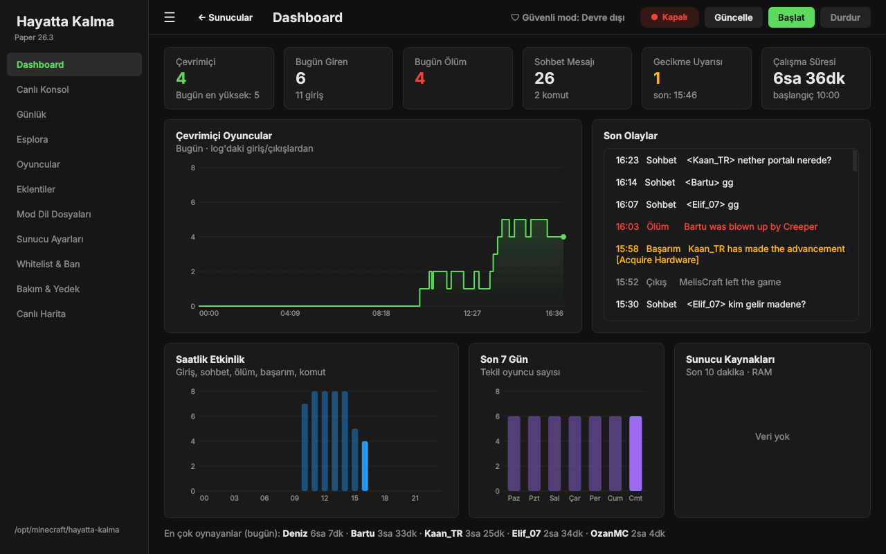
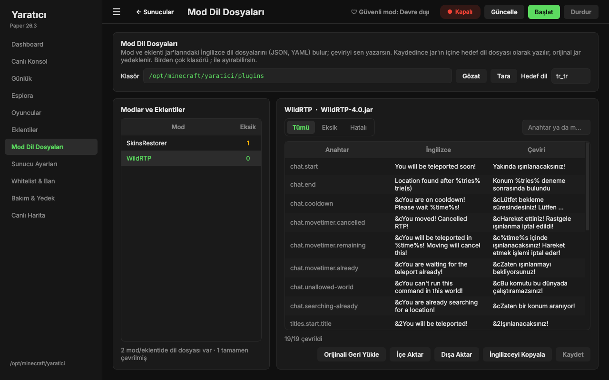
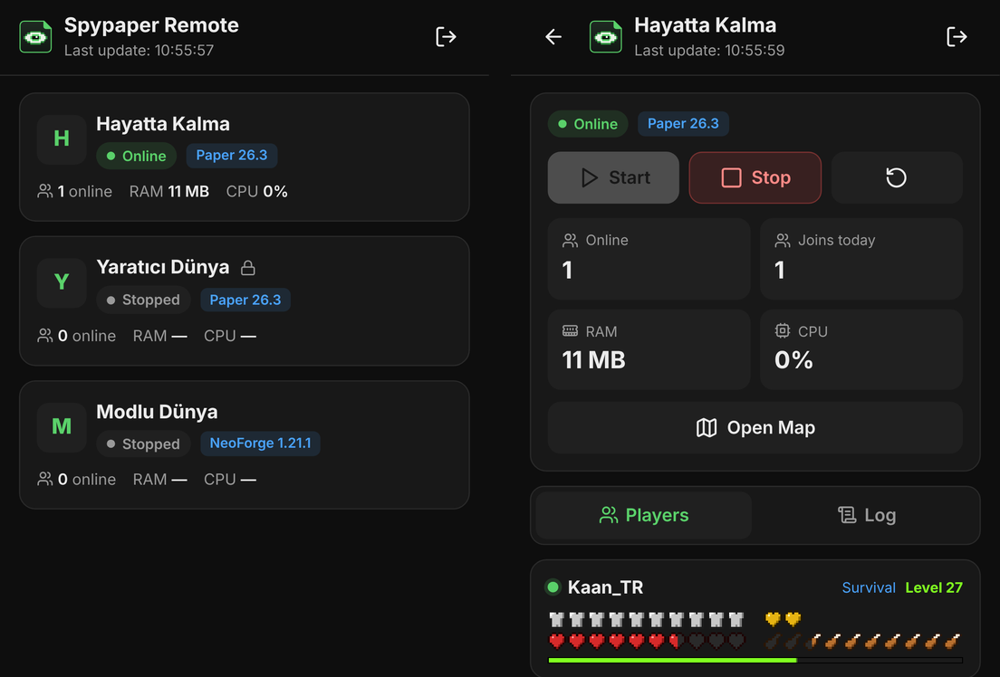
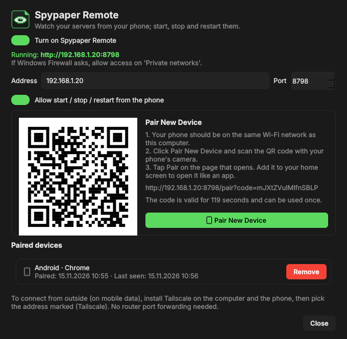

<p align="center"></p>

# Spypaper

[English](README.md) · **Türkçe**

**Minecraft sunucuları için masaüstü yönetim paneli.** Sunucuyu başlat/durdur, konsolu canlı izle, oyuncuların envanterine bak, eklenti ve modları yönet, yedek al, sunucu yazılımını tek tıkla güncelle ve sunucuna özel yapay zeka asistanı **Esplora**'ya danış.

Python + PySide6 ile yazılmıştır, Windows için tek bir `.exe` olarak derlenir. 16 dil desteği vardır. Özgür ve açık kaynaklıdır (GPL-3.0).

**[⬇ Son sürümü indir](https://github.com/TyraelDiablo/Spypaper-Releases/releases/latest)** · **[Hata bildir / öneri yap](https://github.com/TyraelDiablo/Spypaper-Releases/issues)**

> Spypaper resmi bir Minecraft ürünü değildir; Mojang Studios ya da Microsoft ile bağlantısı yoktur.



---

## Özellikler

| Bölüm | Neler yapar |
|---|---|
| **Ana ekran** | Birden çok sunucuyu kartlar halinde listeler; paneli açmadan hızlı başlat/durdur, düzenle, klasörü aç. |
| **Yeni sunucu** | Sıfırdan sunucu oluştur: yazılımı ve Minecraft sürümünü seç; RAM, port, MOTD, oyun modu ve zorluğu ayarla; Spypaper sunucuyu indirip klasörü hazırlar. |
| **Dashboard** | Anlık RAM/CPU, çevrimiçi oyuncular, günlük giriş, ölüm, gecikme ve hata sayıları, saatlik etkinlik grafiği. |
| **Canlı Konsol** | Renkli konsol, komut geçmişi, sunucu mesajlarının panel diline çevrilmesi (isteğe bağlı). |
| **Günlük** | `logs/latest.log` ve arşivlenmiş `.log.gz` dosyalarından olaylar, oturumlar ve grafikler. Sunucu panel dışında açılmış olsa bile takip eder. |
| **Esplora** | API anahtarıyla çalışan, yalnızca bu sunucunun yönetimine odaklı yapay zeka asistanı (Anthropic Claude, Google Gemini, OpenAI ve uyumlu servisler). Kategorili hazır sorular, mesaj balonları, durdurma ve yeniden oluşturma. Komut çalıştırmaz; önerdiği komutları sen **▶ Çalıştır** ile gönderirsin. |
| **Oyuncular** | Can, açlık, zırh ve XP Minecraft'ın kendi göstergeleriyle; oyuncunun oyun modu. Envanter, zırh ve Ender sandığı; eşya ikonları (çit, merdiven gibi blok eşyalar oyunun 3D modellerinden çizilir), büyüler, kaplamalar, dayanıklılık. Eşya adları seçili dilde (Minecraft'ın kendi dil dosyalarıyla). Sık kullanılan oyuncu komutları. Minecraft 26.x'in yeni `world/players/` düzenini de okur. |
| **Eklentiler / Modlar** | Paper, Purpur ve Spigot'ta `plugins/`, Fabric, Quilt, Forge ve NeoForge'da `mods/` klasörünü yönetir: ekle, sil, devre dışı bırak. |
| **Mod Dil Dosyaları** | Mod ve eklenti jar'larının içindeki İngilizce dil dosyalarını, yolu ne olursa olsun bulur (`assets/*/lang/en_us.json`, `lang/en.yml`, `locales/locale.json`…). JSON ve YAML, düz ya da iç içe. Çeviriyi sen yazarsın; panel jar'ın içine ve eklentinin kendi klasöründeki kopyaya kaydeder. Biçim kodu kontrolü (`%s`, `%player%`, `§a`, `&c`, `<red>`), dışa/içe aktarma, orijinali geri yükleme. |
| **Sunucu Ayarları** | `server.properties` düzenleyici, Java yolu, RAM, jar, sunucu ikonu. |
| **Whitelist & Ban** | Whitelist, ban ve op listeleri. |
| **Bakım & Yedek** | Dünya (Overworld, Nether, End) yedeği, otomatik yedek ve bakım modu. |
| **Canlı Harita** | BlueMap 3D haritası panelin içinde açılır. BlueMap kurulu değilse sunucunun yazılımına ve sürümüne uygun olanı Modrinth'ten indirip kurar, doku indirme iznini (onayınla) ayarlar. |
| **Sunucu Yazılımı** | **Paper, Purpur, Vanilla, Fabric, Forge, NeoForge** için sürüm seçip indirme/kurma. Mümkün olduğunda SHA-256 / SHA-1 doğrulaması yapılır, eski jar `backups/jars/` klasörüne taşınır. |
| **Spypaper Remote** | Sunucularını telefondan izle; başlat, durdur, yeniden başlat. QR kodla eşleşir; mağaza, hesap ya da veritabanı gerekmez. Bkz. [Spypaper Remote](#spypaper-remote-telefon). |
| **Güvenlik** | 4 seviyeli güvenli mod (tehlikeli komutlar için onay, engelleme ya da salt okunur) ve sunucu başına isteğe bağlı PIN. |
| **Görünüm** | 7 tema, yazı boyutu, yüksek kontrast, animasyonları azaltma, sağdan sola diller, [Lucide](https://lucide.dev) ikonları, Windows mesaj kutuları yerine panele özel uyarı/soru pencereleri. |

---

## Ekran görüntüleri

| | |
|---|---|
|  |  |
| **Ana ekran:** birden çok sunucu, durum ve yazılım rozetleri | **Günlük:** latest.log ve arşivlerden olaylar, oturumlar |
|  |  |
| **Esplora:** sunucuya özel yapay zeka, önerilen komutu tek tıkla gönder | **Mod Dil Dosyaları:** eklenti/mod dil dosyalarını yan yana çevir |
|  | |
| **Açık tema:** 7 temadan biri | |

---

## Gereksinimler

- **Windows 10/11** (geliştirme sırasında Linux ve macOS'ta da çalışır; API anahtarı şifrelemesi yalnızca Windows'ta DPAPI ile yapılır).
- **Java**: Minecraft sürümüne uygun (1.20.5 ve sonrası için Java 21, 26.x için Java 25). Panel Java'yı kendisi kurmaz.
- Kaynaktan çalıştırmak için: **Python 3.10+** ve [uv](https://docs.astral.sh/uv/).

---

## Hızlı başlangıç

### Hazır exe ile

1. [Releases](https://github.com/TyraelDiablo/Spypaper-Releases/releases/latest) sayfasından `Spypaper.exe` dosyasını indirip bir klasöre koy (ör. `D:\Spypaper\`).
2. Exe'yi aç → sıfırdan kurmak için **Yeni Sunucu Oluştur**, elindeki bir sunucu için **Var Olanı Ekle** (jar, sürüm ve yazılım otomatik algılanır).
3. Eşya adları ve ikonlar için **Oyuncular → Oyun Dosyalarını Al** (aşağıya bak).

`config.json` ilk açılışta exe'nin yanında oluşur. Sunucu profilleri, ayarlar ve şifrelenmiş API anahtarı buradadır, **paylaşma**.

### Kaynaktan

Kaynak kod `src` klasöründedir.

```bat
src\calistir.bat
```

ya da

```bat
cd src
uv run --with nbtlib --with pyside6 --with psutil --with pyyaml --with segno python main.py
```

### Exe derleme

```bat
src\build.bat
```

Çıktı `src\dist\Spypaper.exe` olur. Dil dosyaları (`locales/`) ve yasal metinler (`legal/`) exe'nin içine gömülür. Gömülü harita için Qt WebEngine de pakete girdiğinden exe 150 MB civarındadır.

---

## Minecraft dil dosyaları ve ikonlar

Eşya, büyü ve ölüm mesajı gibi oyun metinleri ve eşya ikonları Minecraft'ın kendi dosyalarından okunur. Bu dosyalar Mojang'a ait olduğu için Spypaper ile **dağıtılmaz**; her kullanıcı kendi bilgisayarında hazırlar:

**Oyuncular** sayfasındaki **Oyun Dosyalarını Al** düğmesi ya da **☰ → Oyun Dosyaları** ile:

1. **Bu bilgisayardaki Minecraft kurulumundan çıkar:** `.minecraft` otomatik bulunur, internet gerekmez. Önce oyunun o sürümünü launcher'dan bir kez açmış olman gerekir.
2. **Mojang'ın resmî sunucularından indir:** Bilgisayarda Minecraft yoksa (ör. yalnızca sunucu makinesi) kullanılır. İstemci jar'ı geçici olarak indirilir, yalnızca dil dosyaları, ikonlar ve HUD görselleri ayrılıp jar silinir.

Düz resmi olmayan blok eşyalar (çit, merdiven, duvar, basamak…) bu adımda oyunun kendi 3D modellerinden çizilir. Oyun dosyalarını eski bir Spypaper sürümüyle hazırladıysan bu ikonlar ve can/açlık çubukları için **Oyun Dosyaları**'nı yeniden çalıştır.

Dosyalar exe'nin yanındaki `Translation` ve `Icons` klasörlerine yazılır. Komut satırını tercih edenler için `mc_dilleri_cikar.bat` da aynı işi yapar:

```bat
src\mc_dilleri_cikar.bat                  :: panelin 16 dili, en yeni sürüm
src\mc_dilleri_cikar.bat --surum 26.3     :: belirli sürüm
src\mc_dilleri_cikar.bat --hepsi          :: Minecraft'taki tüm diller
```

---

## Sunucu yazılımları

**Güncelle** düğmesi mevcut yazılımı algılar ve aynı yazılımın yeni sürümünü önerir; istersen başka bir yazılıma geçebilirsin.

| Yazılım | Kaynak | Doğrulama | Not |
|---|---|---|---|
| Paper | PaperMC Fill API v3 | SHA-256 | Yalnızca STABLE kanal |
| Purpur | api.purpurmc.org | — | |
| Vanilla | Mojang sürüm listesi | SHA-1 | Yalnızca kararlı sürümler |
| Fabric | meta.fabricmc.net | — | Sunucu başlatıcı jar'ı |
| Forge | files.minecraftforge.net | SHA-1 | Kurulum programı çalıştırılır |
| NeoForge | maven.neoforged.net | SHA-1 | Kurulum programı çalıştırılır; beta sürümler işaretlenir |

Forge (1.17+) ve NeoForge sunucuları jar ile değil, `libraries/.../win_args.txt` argüman dosyasıyla başlatılır. Panel bunu otomatik yapar (`java @user_jvm_args.txt @libraries/.../win_args.txt nogui`).

> PaperMC, isteklerde iletişim bilgisi içeren bir User-Agent ister. ☰ → Genel bölümünden e-posta ya da site adresini girebilirsin.

**Minecraft EULA:** Sunucu ilk kez başlatılırken `eula.txt` kabul edilmemişse panel sana sorar. Panel EULA'yı senin yerine kabul etmez.

---

## Spypaper Remote (telefon)

Sunucularını telefondan izle; başlat, durdur ya da yeniden başlat. Mağazadan indirilecek bir uygulama yok: bilgisayardaki Spypaper küçük bir mobil web uygulaması sunar, telefon bunu tarayıcıda açar. Ana ekrana eklersen uygulama gibi açılır (Android ve iPhone).



**Kurulum**

1. Spypaper'da **☰ → Spypaper Remote**'u aç ve etkinleştir. Windows güvenlik duvarı sorarsa *Özel ağlar*'a izin ver.
2. **Yeni Cihaz Eşle**'ye bas, çıkan QR kodu telefonun kamerasıyla okut. Açılan sayfada **Eşle**'ye dokun.
3. Bu kadar. Telefon eşli kalır; aynı pencereden istediğin zaman kaldırabilirsin.

**Telefonda neler var:** sunucu durumu, RAM/CPU, çevrimiçi oyuncular ve bugünkü girişler, her oyuncunun canı, açlığı, zırhı, seviyesi ve oyun modu (Minecraft tarzı göstergelerle), son log satırları, BlueMap canlı harita bağlantısı ve **Başlat / Durdur / Yeniden Başlat**. Serbest komut gönderme yoktur.

**Güvenlik**

- Remote varsayılan olarak kapalıdır ve yalnızca bilgisayarda Spypaper açıkken çalışır.
- Eşleşme 2 dakika geçerli, tek kullanımlık bir kodla yapılır. Telefon anahtarını HttpOnly çerezde tutar; `config.json`'da yalnızca SHA-256 özeti durur. Veritabanı kullanılmaz.
- Sunucuda PIN varsa telefonda da sorulur (5 yanlış denemede 5 dakika kilitlenir). Güvenli mod *Yüksek* (salt okunur) telefondan kontrolü engeller; telefon kontrolünü tamamen kapatıp yalnızca izleme de yapabilirsin.
- Log satırlarındaki IP adresleri telefona gitmeden gizlenir.
- Bağlantı kendi ağının içinde düz HTTP'dir. **Bunun için modemde port açma.** Dışarıdan (mobil veriyle) erişmek için bilgisayara ve telefona [Tailscale](https://tailscale.com) kur ve Remote penceresinde *(Tailscale)* yazan adresi seç; trafik Tailscale ile şifrelenir.



---

## Esplora (yapay zeka asistanı)

1. ☰ → **Yapay Zeka** → sağlayıcıyı seç, API anahtarını gir → **Bağlantıyı Test Et**.
2. **Modelleri Getir** ile anahtarının erişebildiği modelleri listele.

| Sağlayıcı | Varsayılan model | Not |
|---|---|---|
| Anthropic (Claude) | `claude-sonnet-5-5` | |
| Google Gemini | `gemini-3.8-flash` | Kapatılan bir model için servis yeni model önerirse panel otomatik geçer |
| OpenAI / uyumlu | `gpt-4o-mini` | OpenRouter, LM Studio, Ollama vb. için *Sunucu adresi* alanını kullan |

**Gizlilik:** Esplora'ya soru sorduğunda; sorun, sunucu adı, sürümü, ayarları, eklenti/mod listesi, oyuncu adları, son log satırları ve varsa son çökme raporu seçtiğin yapay zeka sağlayıcısına gönderilir. Ayrıntılar için [GIZLILIK.md](src/legal/GIZLILIK.md).

API anahtarı `config.json` içinde saklanır; Windows'ta kullanıcı hesabına bağlı olarak DPAPI ile şifrelenir.

---

## Arayüz çevirileri

Arayüz metinleri Türkçe yazılır ve `src/tools/translations/*.tsv` tablolarıyla diğer dillere çevrilir.

```bat
cd src
uv run python tools\extract_strings.py      :: koddaki çevrilecek metinleri ve eksikleri listeler
uv run python tools\build_locales.py        :: TSV -> locales\<dil>.json
```

`build_locales.py`, çevirideki yer tutucular (`{n}`, `{name}`…) asıl metinle uyuşmazsa hata verir.

Desteklenen diller: Türkçe, English, Deutsch, Français, Español, Português (Brasil), Italiano, Nederlands, Polski, Русский, Українська, Azərbaycanca, 日本語, 한국어, 简体中文, العربية.

---

## Klasör yapısı

```
Spypaper-Releases/
├─ README.md, README.tr.md
├─ LICENSE                 GNU GPL v3
├─ docs/                  logo ve README görselleri
└─ src/                    kaynak kod
   ├─ main.py              giriş noktası
   ├─ calistir.bat         kaynaktan çalıştır
   ├─ build.bat            exe derle
   ├─ mc_dilleri_cikar.bat Minecraft dil dosyalarını komut satırından çıkar
   ├─ core/                arayüzden bağımsız iş mantığı
   │  ├─ config.py         ayarlar, sunucu profilleri, jar/yazılım algılama
   │  ├─ server.py         sunucu süreci (başlat, durdur, komut)
   │  ├─ software.py       Paper/Purpur/Vanilla/Fabric/Forge/NeoForge sağlayıcıları
   │  ├─ updater.py        indirme ve doğrulama
   │  ├─ players.py        oyuncu verisi (NBT), envanter, Minecraft çevirileri
   │  ├─ logwatch.py       latest.log takibi, olaylar, metrikler
   │  ├─ logtrans.py       sunucu mesajlarını panel diline çevirme
   │  ├─ files.py          eklenti/mod klasörü, server.properties, yedekler
   │  ├─ maintenance.py    bakım modu ve otomatik yedek
   │  ├─ gamefiles.py      Minecraft dil dosyaları ve ikonlar (yerel kurulum ya da Mojang)
   │  ├─ iconrender.py     blok eşya ikonlarını oyunun 3D modellerinden çizer
   │  ├─ modtrans.py       mod/eklenti dil dosyası düzenleyici (JSON, YAML)
   │  ├─ creator.py        yeni sunucu oluşturma
   │  ├─ bluemap.py        BlueMap algılama, Modrinth'ten kurulum, ayarlar
   │  ├─ remote.py         Spypaper Remote web sunucusu (eşleşme, telefon API'si)
   │  ├─ ai.py, esplora.py yapay zeka sağlayıcıları, Esplora kuralları ve hazır sorular
   │  ├─ safemode.py       güvenli mod ve PIN
   │  └─ secrets.py        API anahtarı şifreleme
   ├─ ui/                  PySide6 arayüzü (pencere, sayfalar, temalar, i18n, HUD, pencereler)
   │  └─ assets/           Spypaper logosu (SVG, PNG, ICO)
   ├─ remote_web/          Spypaper Remote telefon uygulaması (HTML, CSS, JS)
   ├─ locales/             derlenmiş arayüz çevirileri
   ├─ tools/               çeviri ve Minecraft dil dosyası araçları
   └─ legal/               gizlilik, üçüncü taraf bildirimleri, lisans kopyası
```

---

## Yol haritası

Sıradaki planlar (sıra değişebilir; önerilerini [Issues](https://github.com/TyraelDiablo/Spypaper-Releases/issues) sayfasına yazabilirsin):

- [ ] **Zamanlanmış görevler:** belirli saatte yeniden başlatma, geri sayım duyurusu, komut ve yedek
- [ ] **Çökme bekçisi:** beklenmedik kapanmada otomatik yeniden başlatma, art arda çökmede durma
- [ ] **Yedekten geri yükleme** ve yedek sayısı sınırı (eski yedekleri otomatik silme)
- [ ] **Eklenti ve mod mağazası:** Modrinth ve Hangar'dan arama, kurma ve güncelleme uyarısı
- [ ] **Discord bildirimleri:** açıldı, kapandı, çöktü, oyuncu girdi (webhook)
- [ ] **Java yöneticisi:** Minecraft sürümüne uygun Java'yı algılama ve indirme
- [ ] **TPS / MSPT grafiği** Dashboard'da
- [ ] **Yapılandırma dosyası editörü** (`paper-global.yml`, `config/*.toml`…) ve biçim denetimi
- [ ] **Panelin kendini güncellemesi** (GitHub Releases)
- [x] **Spypaper Remote:** sunucuları telefondan izleme ve kontrol
- [ ] Spypaper Remote: sohbet, oyuncu işlemleri ve bildirimler

---

## Sorun giderme

- **Eşya adları İngilizce görünüyor ya da ikon yok:** Oyuncular sayfasında **Oyun Dosyalarını Al**'a bas. Sayfanın altında hangi dil dosyasının kullanıldığı yazar.
- **Telefon Spypaper Remote'a bağlanamıyor:** telefon ve bilgisayar aynı Wi-Fi'da olmalı (misafir ağları genelde bunu engeller), Windows güvenlik duvarı Spypaper'a özel ağlarda izin vermeli ve Remote penceresindeki adres bilgisayarın yerel adresi olmalı (genelde `192.168…`). Port meşgulse Remote penceresinden değiştir.
- **Sunucu başlamıyor:** Canlı Konsol'daki hatayı oku ya da Esplora'da *Sunucu neden açılmıyor?* sorusunu kullan. Java sürümünün Minecraft sürümüne uygun olduğundan emin ol.
- **Forge/NeoForge kurulumu başarısız:** Java yolunun doğru olduğunu ve sunucu klasörüne yazma izni olduğunu kontrol et; kurulum çıktısının son satırları pencerede gösterilir.
- **Gemini/OpenAI 429 hatası:** Sağlayıcının istek sınırı doldu; bir süre sonra tekrar dene.

---

## Lisans

Spypaper özgür ve açık kaynak bir yazılımdır; [GNU Genel Kamu Lisansı sürüm 3](LICENSE) (GPL-3.0) ile lisanslanmıştır.
Programı ücretsiz kullanabilir, inceleyebilir, değiştirebilir ve paylaşabilirsin. Değiştirilmiş bir sürümü dağıtırsan
kaynak kodunu da aynı lisansla paylaşman gerekir. Program hiçbir garanti olmadan sunulur.

Copyright © 2026 Serkan Aynacı ([TyraelDiablo](https://github.com/TyraelDiablo))

## Yasal

- [Gizlilik Bildirimi](src/legal/GIZLILIK.md) · [Privacy Notice](src/legal/PRIVACY_EN.md)
- [Üçüncü Taraf Bildirimleri](src/legal/UCUNCU_TARAF.md)

Minecraft, Mojang Studios'un ticari markasıdır. Spypaper, Minecraft'ın hiçbir dosyasını dağıtmaz. Minecraft sunucusu çalıştırmak için [Minecraft EULA](https://aka.ms/MinecraftEULA)'sını kabul etmen gerekir.
